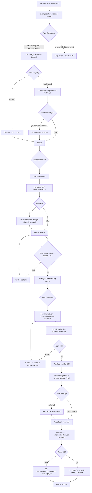
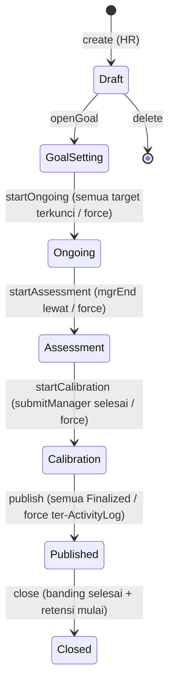
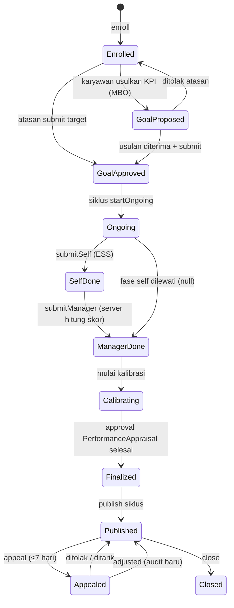
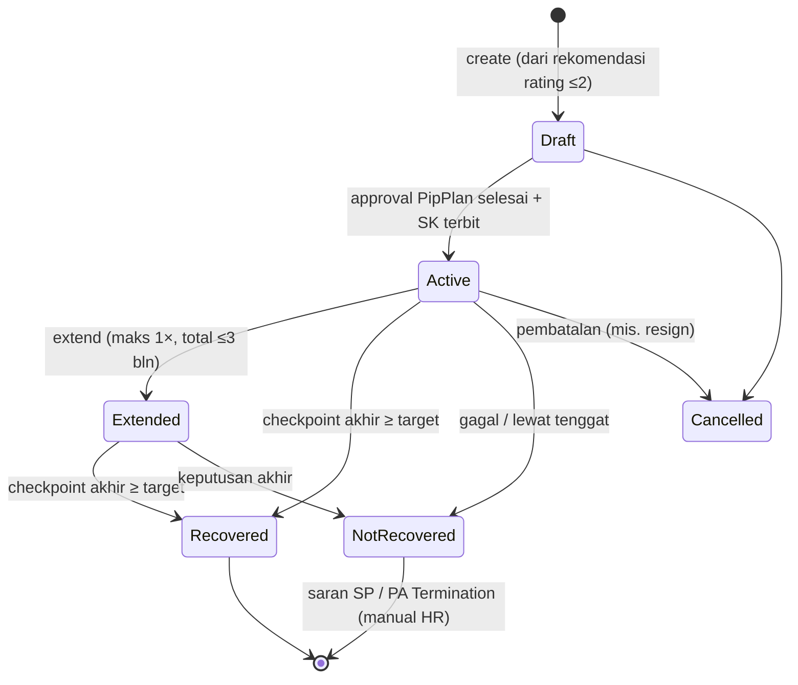
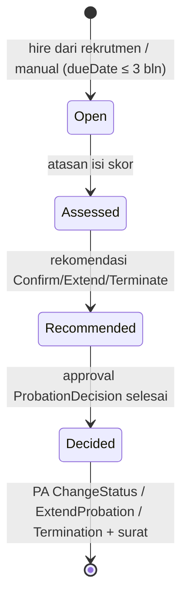
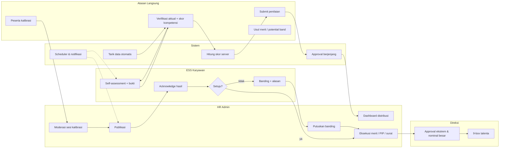

# REKANKERJA PERFORMANCE — DOKUMEN PERENCANAAN & BLUEPRINT (PRA-IMPLEMENTASI)

> **Status: DOKUMEN MURNI — BELUM ADA PERUBAHAN KODE APLIKASI** (sesuai mandat user:
> "buat dokuman dulu jangan ada perubahan dulu di applikasi").
>
> Asal-usul: permintaan user — "jika saya ingin mengimplementasikan module baru
> performance/penilaian kerja, coba analisa dari pengetahuan kamu untuk module
> performance ini, dan analisa tier app untuk module performance ini, dan penerapan
> pada applikasi rekan kerja kita: (1) buatkan blueprint lengkap apa yang akan kamu
> buat, (2) buatkan alur lengkap bisnis proses".
>
> Dokumen ini menggabungkan TIGA hal dalam satu file (mengikuti konvensi
> `DEVELOPMENT-PLAN-RECRUITMENT.md`):
> - **Bagian B** — Analisa domain dari pengetahuan manajemen kinerja (knowledge base).
> - **Bagian C** — Analisa tier aplikasi (benchmark pasar + tier internal mesin RekanKerja).
> - **Bagian D** — **POIN 1: Blueprint lengkap** (arsitektur, data model, formula, API, UI, fase P0–P9).
> - **Bagian E** — **POIN 2: Alur lengkap bisnis proses** (9 alur + diagram + matriks guard).
>
> Basis teknis: kondisi RekanKerja per 12 Okt 2026 — 8 modul hidup (HR Base, Payroll,
> Attendance, Leave, Travel, Medical, Whistleblowing, Recruitment) + ESS + Portal
> Kandidat; approval engine 9 docType parametrik 6-dimensi; dwibahasa ID/EN; multi-tenant
> PostgreSQL 3 schema; enkripsi vault; eSign; Letters; ActivityLog; MetricSnapshot.
> **AMANDEMEN 1 (12 Okt 2026)** — arahan user: (1) UX pengisian KPI harus **user-friendly
> & memudahkan user** → KPI Builder §18.1; (2) fasilitas **"Salin dari periode
> sebelumnya"** (copy-from-previous-cycle) → §18.2 (4 titik masuk) + §18.3 (ESS) +
> §18.4 (anti-stale) + API §17 + 3 kolom provenance §15 + alur §25–§26 + guard §35
> baris 24–25 + register D13–D15 + wireframe Lampiran G. Tetap DOKUMEN MURNI — belum
> ada perubahan kode aplikasi.
> **AMANDEMEN 2 (12 Okt 2026)** — arahan user, 7 fitur kemudahan: **Sisi pengguna**
> (karyawan & atasan): ① impor target KPI / realisasi akhir tahun massal via template
> Excel → §18.5; ② tarikan otomatis modul lain (mis. % kehadiran dari Attendance)
> langsung mengisi KPI → §18.6 (perkuat §16 yang sudah ada); ③ autosave berkala ke
> draf DB — anti hilang data saat koneksi putus/browser tertutup → §18.7; ④ progress
> tracker bar "Formulir Anda selesai 60%" → §18.7. **Sisi admin (HR)**: ⑤ HR Command
> Center + nudge "Remind All"/WA/Email alert → §18.8; ⑥ version control pustaka
> KPI/kompetensi (ubah tahun ini tanpa merusak data tahun lalu) → §18.9. **Lainnya**:
> ⑦ kurva Bell (bell curve) di menu Kalibrasi untuk HR/Direksi mendeteksi atasan
> "terlalu pelis/royal" → §18.10; pengingat multi-kanal WA/Slack dengan tautan
> langsung ke formulir → §18.8 + §19. Semua tetap DOKUMEN MURNI.

---

## Daftar Isi

- Bagian A — Pendahuluan
  - §0 Asal-usul & cara membaca
  - §1 Ringkasan eksekutif
- Bagian B — Analisa Domain Manajemen Kinerja (pengetahuan)
  - §2 Definisi & siklus (PDCA)
  - §3 Metodologi penilaian (KPI, MBO, OKR, BSC, kompetensi, 360, continuous)
  - §4 Anatomi formula penilaian
  - §5 Rating, distribusi & kalibrasi
  - §6 Konsekuensi & tindak lanjut (merit, PIP, promosi)
  - §7 Konteks regulasi Indonesia
  - §8 Bias & antipola yang harus didesain keluar
- Bagian C — Analisa Tier Aplikasi
  - §9 Tier pasar aplikasi HRIS (benchmark fitur performance)
  - §10 Posisi & keputusan tier RekanKerja
  - §11 Tier internal mesin RekanKerja (approval, laporan, akses)
- Bagian D — Blueprint Implementasi (POIN 1)
  - §12 Misi & prinsip desain
  - §13 Keputusan arsitektur
  - §14 Struktur menu & halaman (admin + ESS)
  - §15 Data model final (17 model)
  - §16 Formula perhitungan final
  - §17 API blueprint
  - §18 Standar UI/UX (+ 18.1 KPI Builder · 18.2 Salin dari periode sebelumnya ·
    18.3 ESS periode lalu · 18.4 Anti-stale — AMANDEMEN 1 · 18.5 Impor Excel massal ·
    18.6 Tarikan otomatis antar-modul · 18.7 Autosave & progress tracker ·
    18.8 HR Command Center & nudge · 18.9 Versioning pustaka · 18.10 Bell curve —
    AMANDEMEN 2)
  - §19 Integrasi lintas modul
  - §20 Rencana eksekusi fase P0–P9 + backlog
  - §21 Quality gates & Definition of Done
  - §22 Risiko & mitigasi
  - §23 Register keputusan (bisa diubah user)
- Bagian E — Alur Bisnis Proses Lengkap (POIN 2)
  - §24 Peta proses tingkat tinggi & aktor
  - §25 Alur 1 — Setup master & pembukaan siklus
  - §26 Alur 2 — Penetapan KPI / target
  - §27 Alur 3 — Check-in berjalan & revisi tengah tahun
  - §28 Alur 4 — Evaluasi masa percobaan (integrasi rekrutmen)
  - §29 Alur 5 — Penilaian akhir periode (self → atasan → 360)
  - §30 Alur 6 — Kalibrasi & finalisasi berjenjang
  - §31 Alur 7 — Publikasi, acknowledgement & banding
  - §32 Alur 8 — Konsekuensi (merit matrix, PA, surat, PIP entry)
  - §33 Alur 9 — PIP end-to-end
  - §34 Diagram aliran lengkap (Mermaid ×6)
  - §35 Matriks guard / aturan transisi
  - §36 Matriks aktor × menu × endpoint
  - §37 Kepatuhan UU PDP sepanjang siklus
- Lampiran A–G (matriks metodologi, KPI library contoh, skala rating, formulir contoh,
  glossary, asumsi, wireframe KPI Builder · salin periode lalu · impor Excel ·
  command center · bell curve · progress bar — AMANDEMEN 1+2)

---
---

# BAGIAN A — PENDAHULUAN

## 0. Asal-usul & Cara Membaca

Dokumen ini adalah dokumen perencanaan TAHAP NOL untuk modul **Performance
(Penilaian Kerja / Performance Management)**. Semua di bawah ini adalah DESAIN —
belum satu baris pun kode aplikasi berubah. Tujuannya: user bisa membaca end-to-end
apa yang akan dibangun, menyetujui/mengubah keputusan (lihat §23 Register Keputusan),
baru eksekusi per fase §20.

Urutan membaca yang disarankan:
1. **§1 Ringkasan eksekutif** — 5 menit memahami bentuk akhir.
2. **Bagian B** — kenapa desainnya begini (dasar pengetahuan).
3. **Bagian C** — di posisi tier mana modul ini bermain & kenapa.
4. **Bagian D** — blueprint teknis (untuk review detail / persetujuan).
5. **Bagian E** — alur bisnis (untuk HR user memvalidasi prosesnya benar secara bisnis).

## 1. Ringkasan Eksekutif

**Visi modul**: mengelola siklus hidup kinerja karyawan dari ** penetapan target →
monitoring berjalan → penilaian → kalibrasi → hasil → konsekuensi** (bonus/kenaikan/
promosi/perbaikan), menjadi modul yang **MENUTUP lingkaran** modul-modul yang sudah ada:
Rekrutmen melahirkan karyawan → Performance menilai → hasilnya mengalir ke Payroll
(bonus/kenaikan), Personnel Action (promosi/perpanjangan prob/mutasi), Disciplinary
(SP/PIP), dan Letters (surat hasil penilaian).

**Bentuk akhir (7 kalimat)**:
1. HR membuat **siklus penilaian** (default: tahunan) dengan jendela fase yang digerbangkan
   otomatis (isi target → berjalan → isi penilaian → kalibrasi → publikasi).
2. Tiap karyawan aktif terdaftar sebagai peserta dengan **template bobot** (default 70%
   KPI / 20% kompetensi / 10% core values — dapat diatur per siklus).
3. Atasan menetapkan **KPI terukur** dari pustaka KPI (ada sumber data otomatis dari
   Attendance/Payroll/Rekrutmen) + kompetensi perilaku; karyawan boleh mengusulkan;
   target dikunci setelah disetujui. Pengisian lewat **KPI Builder** ramah (wizard 4
   langkah, meter bobot, autosave — §18.1) dengan tombol **"Salin dari periode
   sebelumnya"** (§18.2): 1 klik membawa struktur + target + bobot tahun lalu sebagai
   titik awal — capaian direset, atasan menyesuaikan lalu submit (AMANDEMEN 1).
4. Sepanjang periode: **check-in 1-on-1** terdokumentasi + progress aktual KPI
   (checkpoint tengah & akhir tahun).
5. Akhir periode: **self-assessment → penilaian atasan → 360 feedback (opsional per
   siklus, anonim)** → **kalibrasi antar-atasan** (ter-audit) → finalisasi lewat
   **approval berjenjang parametrik** (engine yang sama dengan modul lain).
6. Hasil dipublikasi ke ESS karyawan (acknowledgement + jendela banding), lalu
   menghasilkan **rekomendasi merit matrix** (bonus % & kenaikan % per rating) yang bisa
   diteruskan jadi input Payroll / draft Personnel Action / surat resmi.
7. Kinerja rendah masuk **PIP** terstruktur (checkpoint 30/60/90 hari) dengan ujung:
   pulih / perpanjang / SP / pengakhiran — dan karyawan baru masuk **evaluasi masa
   percobaan** otomatis dari onboarding rekrutmen (3 bulan, keputusan
   konfirmasi/perpanjangan/pengakhiran sesuai UU 13/2003 Pasal 60).

**Analogy di ekosistem yang sudah ada**: modul ini = "Recruitment untuk karyawan
existing" — sama-sama punya dokumen bernomor, state machine, approval berjenjang,
notifikasi, surat, laporan dokumen bilingual; bedanya objeknya **penilaian orang**
bukan **lowongan**.

**Skala**: 17 tabel baru di schema tenant, ±14 endpoint API admin + 4 ESS, 12 halaman
admin + 4 layar ESS, 10 fase eksekusi (P0–P9), 3 di antaranya tergolong L/L–XL
(lihat §20). Estimasi total ± 60–75 hari kerja efektif bila dieksekusi penuh.
(AMANDEMEN 1 hemat arsitektur: 0 tabel/endpoint/halaman baru — hanya 3 kolom
provenance + 3 action verbs + 1 query param pada endpoint `goals` yang sudah ada.)
(AMANDEMEN 2 hemat arsitektur: 0 tabel/endpoint/halaman baru — 8 action verbs +
3 query param pada endpoint yang sudah ada + kolom versioning di 2 model pustaka;
Command Center = tab baru di halaman Siklus; bell curve = tampilan data distribusi
yang sudah dikembalikan endpoint kalibrasi.)

---
---

# BAGIAN B — ANALISA DOMAIN: PENGETAHUAN MANAJEMEN KINERJA

## 2. Definisi & Siklus Manajemen Kinerja

Manajemen kinerja = proses berkelanjutan untuk **menyelaraskan kontribusi individu
dengan tujuan organisasi**, bukan sekadar formulir tahunan. Kerangka industrinya
adalah siklus **PDCA**:

```
   ┌───────────────────────────────────────────────────────────────┐
   │                                                               │
   ▼                                                               │
PLAN ──► DO ──────► CHECK ──────► ACT ──► (umpan balik ke PLAN tahun berikut)
(target/      (bekerja +       (penilaian:       (hasil → reward/
 KPI/set        check-in +        self, atasan,    pengembangan/
 kesepakatan)   umpan balik       360, kalibrasi)  PIP/promosi)
   │            berjalan)              │
   │                                      │
   └── goal cascading: perusahaan → unit → individu ──┘
```

Empat fase itu memetakan langsung ke fitur:
| Fase PDCA | Fitur RekanKerja | Fase eksekusi |
|---|---|---|
| **Plan** | Siklus penilaian + template bobot + penetapan KPI/target + approval target | P1 |
| **Do** | Check-in 1-on-1 terdokumentasi + progress aktual (checkpoint tengah tahun) + revisi target | P2 |
| **Check** | Self-assessment + penilaian atasan + aktualisasi KPI final + 360 feedback | P3 |
| **Check+** | Kalibrasi antar-atasan (konsistensi & keadilan lintas tim) + finalisasi berjenjang | P4 |
| **Act** | Publikasi hasil + acknowledgement + banding + merit matrix + PA + PIP | P4–P6 |

**Prinsip kunci yang dipegang modul ini**: penilaian yang hanya setahun sekali adalah
antipola (lihat §8); karena itu **check-in adalah warga kelas satu** (bukan fitur tempelan)
— progres KPI tengah tahun dan catatan check-in menjadi bukti yang meminimalkan
*recency bias* saat penilaian akhir.

## 3. Metodologi Penilaian (Perbandingan & Pilihan)

Tidak ada satu metodologi yang "benar"; perusahaan memilih campuran. Berikut enam
metodologi inti dan posisi RekanKerja terhadapnya (matriks lengkap di Lampiran A):

### 3.1 KPI (Key Performance Indicator) — BASIS UTAMA (diadopsi)
- **Apa**: metrik terukur per individu/posisi dengan target eksplisit (mis. "tagih
  piutang > Rp X", "customer satisfaction ≥ 4,5", "waktu tutup PR ≤ 30 hari").
- **Kekuatan**: objektif, bisa diaudit, mudah dikomunikasikan, cocok budaya data.
- **Kelemahan**: yang tak terukur jadi tak dihargai; kualitas bisa dikorbankan demi
  angka bila KPI salah dirancang.
- **Posisi**: komponen utama (default bobot 70%). Pustaka KPI per-fungsi + sumber data
  otomatis dari modul yang sudah ada = nilai tambah nyata vs aplikasi kompetitor.

### 3.2 MBO (Management by Objectives) — GAYA PENETAPAN TARGET (diadopsi implisit)
- **Apa**: atasan-bawahan menyepakati target (dua arah), dievaluasi capaian.
- **Posisi**: mekanisme "self-propose target + approval atasan" adalah MBO modern;
  kami mengadopsinya sebagai **mode pengisian target** (bukan metodologi terpisah).

### 3.3 OKR (Objectives & Key Results) — TIDAK DIADOPSI PENUH (backlog)
- **Apa**: kuartalan, ambisius (0,7 = baik), transparan lintas tim, dipisah dari
  penilaian formal (best practice agar orang berani menarget ambisius).
- **Kenapa tidak sekarang**: OKR menuntut ritme kuartalan, board transparansi lintas
  unit, dan budaya yang matang; untuk target pasar RekanKerja (menengah, siklus
  tahunan) menambah beban adopsi. **Backlog §20**: mode `cycleType=Quarterly` +
  board OKR, dipicu permintaan user.

### 3.4 BSC (Balanced Scorecard) — DIADOPSI SEBAGAI KATEGORI KPI
- **Apa**: menyeimbangkan 4 perspektif — finansial, pelanggan, proses internal,
  pertumbuhan & pembelajaran.
- **Posisi**: tidak dibangun sebagai fitur terpisah; **kategori KPI** diberi label
  4 perspektif BSC sebagai panduan penyusunan pustaka KPI (mencegah KPI semua-keuangan).

### 3.5 Penilaian Kompetensi (behavioral) — DIADOPSI (komponen kedua)
- **Apa**: menilai PERILAKU terhadap definisi kompetensi berjenjang (mis. "komunikasi
  level 3: menyampaikan argumen terstruktur…") — biasanya 5–10 kompetensi per
  template: teknis + manajerial + nilai inti.
- **Kekuatan**: menilai "bagaimana", bukan hanya "berapa"; menopang promosi &
  pengembangan.
- **Kelemahan**: subjektif → wajib deskriptor level yang eksplisit + contoh perilaku
  (anchor) agar bisa dipakai konsisten; 360 membantu.
- **Posisi**: komponen kedua (default 20% + 10% core values). Model `Competency`
  menyimpan deskriptor 5 level — pola `ScorecardCompetency` modul Rekrutmen dibesarkan.

### 3.6 360-Degree Feedback — DIADOPSI OPSIONAL PER SIKLUS
- **Apa**: masukan dari banyak sudut (rekan sejawat, bawahan, lintas unit) — biasanya
  untuk pengembangan & validasi perilaku, idealnya anonim & ter-agregasi.
- **Posisi**: undangan reviewer oleh atasan/HR; **anonimitas**: skor & komentar hanya
  ditampilkan ter-agregasi ke penilai bila ≥3 responder per kategori; karyawan
  melihat ringkasan 360-nya di hasil. Default **OFF** per siklus (register §23).

### 3.7 Continuous Performance Management (check-in) — DIADOPSI (fase Do)
- **Apa**: ritme 1-on-1 ringan (bulanan/dua-mingguan) — progres, hambatan, umpan
  balik dua arah — menggantikan "kejutan penilaian akhir tahun".
- **Posisi**: `CheckIn` terdokumentasi (agenda/catatan/tindak lanjut), progress KPI
  tengah tahun, dan **umpan balik apresiasi/dukungan** (praise/coaching note ringkas
  tercatat di timeline penilaian).

## 4. Anatomi Formula Penilaian

Skor akhir karyawan = fungsi tiga komponen berbobot. Desain formula harus:
**(a) deterministik & bisa direplay** (audit), **(b) tahan salah-input** (validasi bobot),
**(c) transparan bagi karyawan** (rincian bisa dilihat di ESS).

### 4.1 Struktur komponen
```
Skor Akhir (0–100) = wKPI    × SkorKPI        (default 70%)
                  + wKomp    × SkorKompetensi (default 20%)
                  + wCore    × SkorCoreValues (default 10%)
                    (wKPI + wKomp + wCore = 100 — divalidasi sistem)
```

### 4.2 Skor KPI individual (per indikator, 0–100)
Setiap KPI punya atribut: **polaritas** (Higher-Better / Lower-Better / Boolean),
**ambang** (batas gagal, target, stretch opsional), **satuan**, **sumber data**
(Manual / Attendance / Payroll / Recruitment / Leave), dan **bobot**.

| Polaritas | Formula (aktual = A, batas gagal = F, target = T) | Catatan |
|---|---|---|
| Higher-Better | `skor = clamp((A − F) / (T − F) × 100, 0, 100)` | di bawah F → 0; mencapai T → 100; bila `stretch` diisi & A > T → maksimum 120 (butuh `stretchValue`) |
| Lower-Better | `skor = clamp((F − A) / (F − T) × 100, 0, 100)` | contoh: tingkat error — F=10%, T=2%; A di atas F → 0 |
| Boolean | `skor = 100 bila tercapai; 0 bila tidak` | untuk syarat mutlak (mis. "tidak ada pelanggaran SHE") — dapat ditandai `isCritical` |

`SkorKPI = Σ(skor_i × bobot_i) / Σ(bobot_i)` — jumlah bobot KPI **wajib 100**
(validasi UI + server).

### 4.3 Skor kompetensi & core values
Tiap kompetensi dinilai skala 1–5 oleh penilai (atasan; 360 memperkaya sebagai masukan
TIDAK langsung mengubah skor kecuali diaktifkan — register §23):
`SkorKompetensi = Σ(nilai_i / 5 × 100 × bobot_i) / Σ(bobot_i)`.

### 4.4 Konversi ke rating (5 skala — default, bisa diubah §23)
| Rentang skor akhir | Rating | Label ID | Label EN | Warna UI |
|---|---|---|---|---|
| 90–120 | 5 | Sangat Baik | Outstanding | emerald |
| 80–89 | 4 | Baik | Exceeds Expectations | hijau tua |
| 70–79 | 3 | Cukup | Meets Expectations | netral/abu |
| 60–69 | 2 | Kurang | Below Expectations | amber |
| < 60 | 1 | Sangat Kurang | Needs Improvement | merah |

> Catatan penting tentang **120 vs skala 100**: skor stretch di atas 100 hanya mungkin
> bila KPI punya target stretch; rating 5 dipatok di ≥90 agar tetap dapat dicapai tanpa
> stretch (keadilan lintas KPI yang tidak punya stretch).

### 4.5 Keputusan kelulusan prob & ambang PIP (default, register §23)
- **Lulus percobaan**: skor ≥ 70 DAN tidak ada KPI `isCritical` yang gagal (skor 0).
- **Masuk PIP**: rating ≤ 2, ATAU rekomendasi eksplisit atasan atas pola perilaku
  meski rating 3 (dengan justifikasi tertulis).

## 5. Rating, Distribusi & Kalibrasi

### 5.1 Kenapa kalibrasi wajib
Tanpa kalibrasi, rating mencerminkan **kebiasaan atasan**, bukan kinerja: ada atasan
"murah hati" (semua dapat 5) dan "ketat" (semua dapat 3) → bonus/promosi tidak
adil lintas tim dan rawan sengketa. Kalibrasi = forum antar-atasan (dipandu HR) yang
menyetarakan standar sebelum finalisasi.

### 5.2 Mekanisme yang didesain
1. **Dashboard distribusi** per atasan/unit sebelum finalisasi (bar chart rating,
   rata-rata skor, % rating 5) → anomali terlihat (leniency/strictness/central
   tendency — §8).
2. **Sesi kalibrasi** per lingkup unit (peserta: atasan-atasan + HR; ketua: kepala unit).
3. **Keputusan kalibrasi ter-audit**: setiap perubahan rating/skor final = baris
   `CalibrationDecision` (dari → ke, alasan wajib, aktor, waktu). Tidak ada
   perubahan senyap — jejak penuh (kepatuhan & sengketa ketenagakerjaan).
4. **Panduan distribusi** (guideline, BUKAN paksaan): mis. referensi umum rating 5
   ±10%, rating 1–2 ±10% per unit — ditampilkan sebagai garis bantu, force-distribution
   **default OFF** (register §23; forced ranking bersejarah kontroversial & tidak cocok
   perusahaan < 200 orang).

### 5.3 9-Box (performance × potential)
Matriks 9 kotak sebagai **lensa talenta** (siapa dipromosikan/dikembangkan/diperbaiki)
- sumbu performance = rating final; sumbu potential = penilaian potensi 1–3 oleh
  atasan berjenjang pada sesi calibrasi (fitur ringan: kolom `potentialBand` di
  AppraisalRecord yang diisi saat kalibrasi). Tampilan Hasil & 9-Box = **akses
  terbatas HR + direksi** (matriks akses §11.3).

## 6. Konsekuensi & Tindak Lanjut

Hasil penilaian harus BERBUAH, kalau tidak karyawan belajar cepat bahwa formulir ini
teater. Empat saluran konsekuensi yang didesain (detail alur §32):

1. **Merit matrix → bonus & kenaikan gaji** (discretionary; THR TIDAK terikat kinerja —
   wajib menurut UU, lihat §7): matriks rating × band kenaikan (mis. rating 5 →
   bonus 2× bulan & kenaikan 8–12%; rating 3 → 0,5–1× & 3–5%; rating 1–2 → 0 & 0).
   Nominal kenaikan/bonus diusulkan sebagai `MeritRecommendation` → **approval
   berjenjang berbasis NOMINAL** (tier uang — §11.1) → jadi input PayrollRun
   (komponen bonus/adjustment) dan/atau draft PersonnelAction SalaryAdjustment.
2. **Promosi / mutasi**: rating ≥ 4 + potentialBand tinggi → draft PA Promotion
   (tetap diproses lewat modul Personnel Action existing — bukan bypass).
3. **PIP**: rating ≤ 2 → alur terstruktur 30/60/90 hari (§33). Kegagalan PIP
   bermuara ke **SP bertingkat / pengakhiran** melalui DisciplinaryRecord +
   PersonnelAction — SEMUA ter-jejak, karena PHK alasan kinerja wajib punya
   pembuktian proses (§7.3).
4. **Pengembangan**: kompetensi skor rendah → rencana pelatihan (catatan
   pengembangan di AppraisalRecord; modul Training adalah backlog terpisah di luar
   cakupan dokumen ini).

## 7. Konteks Regulasi Indonesia (tidak diubah, hanya dipatuhi)

### 7.1 UU 13/2003 Ketenagakerjaan
- **Pasal 60** — perjanjian percobaan: maksimal **3 bulan**, **harus tertulis**;
  upah tidak boleh di bawah upah minimum. → Evaluasi prob menolak durasi > 3 bulan;
  "perpanjangan masa percobaan" tidak dikenal UU — yang benar adalah **perpanjangan
  PKWT** atau keputusan konfirmasi; sistem menyediakan `ExtendProbation` PA sebagai
  *perjanjian tertulis* pengganti (praktik pasar umum: perjanjian kerja baru),
  dengan peringatan di UI bahwa penilaian percobaan ke-2 harus berdiri di atas
  perjanjian yang sah.
- **Pasal 157** — THR adalah kewajiban tahunan yang TIDAK bergantung kinerja
  → modul TIDAK menyentuh THR; bonus kinerja = remunerasi tambahan terpisah
  (Pasal 156: upah termasuk pembayaran atas prestasi kerja — dasar hukum sahnya
  bonus berbasis kinerja).
- **Pasal 52 & 153** — PHK: alasan pelanggaran/peraturan perusahaan butuh prosedur
  bertingkat (SP; UU menuntut kesempatan perbaikan — sebelum UU Cipta Kerja 4×SP,
  kini bisa 1×SP bila diatur di PK/PP) → modul memastikan jejak PIP + SP tersambung
  sebagai bukti proses yang layak bila berujung pengakhiran.

### 7.2 PP 35/2021 (perubahan PP 36/2021)
- **Pasal 8–9** — konversi PKWT → PKWTT setelah 3 tahun (atau 5 tahun menurut
  asas preferensi bagi yang memenuhi syarat): penilaian kinerja adalah dasar
  perusahaan untuk tidak konversi/ memperpanjang → riwayat penilaian harus
  **eksporabel & ter-audit** (fitur register riwayat per karyawan + ekspor dokumen
  laporan §20-P8). Inilah alasan kuat `CalibrationDecision` dan `ActivityLog`
  wajib di modul ini.

### 7.3 UU PDP (No. 27/2022)
- Data kinerja, feedback 360, hasil PIP = **data pribadi** (bahkan cenderung
  sensitif karena memengaruhi hak kepegawaian) → akses granular per peran
  (§11.3), retensi terdefinisi, DSR (permintaan subjek data) untuk karyawan
  (perluasan `DataSubjectRequest` yang sudah ada untuk pelamar), dan log aktivitas.
  Detail §37.

### 7.4 SKP ASN (PP 30/2019) — REFERENSI GAYA, BUKAN KEWAJIBAN
Untuk swasta tidak mengikat; namun gayanya (rencana kerja terukur + penilaian
perilaku: orientasi pelayanan, integritas, komitmen, disiplin, kerjasama, kolaborasi,
kepemimpinan) adalah kerangka yang baik — pustaka `Competency` default kami
meniru kategori perilaku ini (berlabel nilai inti perusahaan, bebas dikustomisasi).

## 8. Bias & Antipola yang Harus Didesain Keluar

| # | Bias / antipola | Gejala | Sarana desain penangkalnya |
|---|---|---|---|
| 1 | **Recency bias** | kinerja 3 bulan terakhir menutupi 9 bulan pertama | checkpoint aktual tengah tahun + timeline check-in + bukti (bukti lampiran per KPI) |
| 2 | **Halo/horns effect** | satu kejayaan/kecelakaan menentukan semua skor | skor per-KPI terpisah + komentar wajib bila skor ekstrem (≤2 / =5) + 360 sebagai pembanding |
| 3 | **Central tendency** | semua dinilai "cukup" (aman) | dashboard distribusi per atasan + panduan distribusi + kalibrasi |
| 4 | **Leniency / strictness** | standar beda antar atasan | kalibrasi wajib sebelum finalisasi + metrik bias di laporan P8 |
| 5 | **KPI kabur / tak terukur** | target "meningkatkan layanan" | validasi: KPI wajib punya satuan + ambang + target numerik (atau Boolean eksplisit) |
| 6 | **Bobot menyimpang** | semua bobot di satu KPI | Σbobot = 100 divalidasi UI+server; bobot per item dibatasi 5–50% |
| 7 | **Kejutan akhir tahun** | karyawan tahu hasilnya saat rapat akhir | fase check-in + progress tengah tahun + acknowledgment ESS + jendela banding |
| 8 | **Formulir teater** | hasil tidak berpengaruh apa-apa | §6: merit/PA/PIP ter-otomasi dari hasil |
| 9 | **Sarkasme tertulis di 360** | umpan balik merusak, bukan membangun | panduan bahasa + moderasi HR sebelum tampil + anonimitas ter-agregasi ≥3 |
| 10 | **Penilaian atasan dirinya** | siapa menilai siapa tidak jelas | snapshot manager saat peserta didaftarkan (atasan menilai; atasan atasannya mengkalibrasi) |

---
---

# BAGIAN C — ANALISA TIER APLIKASI

## 9. Tier Pasar Aplikasi HRIS & Fitur Performance Modulenya

Pasar HRIS lazim dibagi tiga tier. Analisa ini penting untuk memutuskan **fitur mana
yang kita bangun sekarang, mana yang kita tiru polanya, mana yang sengaja tidak** —
agar modul tidak over-engineered (mahal & lambat) atau under-built (tak laku dipakai).

| Aspek | Tier 1 — Enterprise global (contoh kelas: SAP SuccessFactors, Workday, Oracle HCM) | Tier 2 — Mid-market cloud (contoh kelas: Darwinbox, Mekari Talenta/People, Zoho People) | Tier 3 — UKM & lokal/spreadsheet |
|---|---|---|---|
| Siklus penilaian | apa pun: kuartalan/OKR, terus-menerus, project-based | tahunan + mid-year review | tahunan (Excel) |
| Metodologi | OKR + KPI + BSC + kompetensi + goal cascading penuh | KPI + kompetensi + 360 (sering add-on) | KPI sederhana / naratif |
| 360 | penuh, psikometrik, integrasi assessment center | opsional, skala | tidak |
| Kalibrasi | formal (calibration grid, 9-box, talent review, succession) | distribusi + 9-box ringan | tidak |
| Merit/bonus | integrasi compensation planning penuh (salary benchmarking) | rekomendasi → payroll | manual di Excel payroll |
| AI | drafting penilaian, analitik prediktif attrition, sentiment | ringan/absen | tidak |
| Multi-entity & governance | penuh | sebagian | tidak |
| Harga & kompleksitas | sangat mahal, implementasi 6–18 bln | menengah, SaaS bulanan | murah/manual |

## 10. Posisi & Keputusan Tier RekanKerja

**Posisi RekanKerja hari ini**: self-hosted, multi-tenant, menyasar **menengah
(10–500 karyawan)** — secara fitur bermain di **Tier 2 yang solid**, tetapi memegang
beberapa pola arsitektur kelas Tier 1 yang sudah terbukti: approval engine parametrik
6-dimensi berbasis nominal, enkripsi vault, eSign, DSR UU PDP, ActivityLog penuh,
dwibahasa per pengguna, dan laporan dokumen bernomor.

**Keputusan tier untuk modul Performance** (per fitur):

| Fitur performance | Keputusan | Alasan |
|---|---|---|
| Siklus tahunan + fase digerbangkan | **Bangun (inti Tier 2)** | kebutuhan nyata pasar sasaran |
| KPI + sumber data OTOMATIS dari modul internal (Attendance/Payroll/Recruitment/Leave) | **Bangun — nilai jual unik** | kompetitor Tier 2 butuh integrasi eksternal; kita punya datanya sendiri (zero integration) |
| Check-in 1-on-1 + checkpoint tengah tahun | **Bangun** | pembeda kematangan proses; biaya build kecil |
| Kompetensi + core values berbobot | **Bangun** | standar pasar |
| 360 anonim ter-agregasi | **Bangun (opsional per siklus)** | diminta pasar menengah; anonimitas ≥3 wajib (UU PDP + kualitas) |
| Kalibrasi ter-audit + panduan distribusi (tanpa forced ranking) | **Bangun** | keadilan + bukti hukum (PP 35/2021) |
| 9-box + potential band | **Bangun ringan** | lensa HR/direksi; succession penuh = backlog |
| Merit matrix → rekomendasi → approval nominal → Payroll/PA | **Bangun** | menutup lingkaran bisnis (ini "Act") |
| PIP 30/60/90 + sambungan SP/PA | **Bangun** | kepatuhan PHK (§7) |
| Evaluasi masa percobaan dari onboarding | **Bangun** | penutup alur rekrutmen yang sudah hidup |
| Laporan dokumen bertingkat bilingual (pf11–pf44) | **Bangun** | konsistensi modul lain (medical/travel/leave reports) |
| OKR board transparan, ritme kuartalan | **Backlog (Tier 1)** | beban adopsi budaya; menunggu permintaan |
| AI draft penilaian / sentiment check-in | **Backlog (Tier 1)** | infra AI provider sudah ada; nilai belum terbukti bagi target pasar |
| Compensation planning + salary benchmarking | **Backlog (Tier 1)** | cukup merit matrix dulu |
| Assessment center / psikometrik | **Tidak** | ranah vendor khusus |

## 11. Tier INTERNAL Mesin RekanKerja (penerapan konkret)

Ini bagian "analisa tier app" pada level mesin aplikasi kita sendiri — modul
performance harus masuk ke TIGA mekanisme tier yang sudah hidup:

### 11.1 Tier #1 — Approval berjenjang (docType & tier nominal)
Engine approval memakai `ApprovalStructure` (6-dimensi penempatan pemohon:
office/location/unit/position/grade/level) dengan level ber-`minAmount/maxAmount`
untuk docType berbasis uang. Analisa untuk performance:

| docType baru | Sifat tier | Struktur default yang diusulkan |
|---|---|---|
| `PerformanceAppraisal` (finalisasi hasil penilaian) | **NON-nominal** — tier dari dimensi penempatan karyawan YANG DINILAI (bukan pemohon) + berat keputusan | AS-PERF-STD: L1 atasan penilai (submit) → L2 HR_ADMIN (verifikasi proses) → L3 POSISI Direktur (hanya bila: grade/level tertentu ATAU rating ekstrem 1 & 5 ATAU hasil memicu PIP/pengakhiran). Pencocokan 6-dimensi tetap dipakai → per-unit/grade bisa punya jalur berbeda |
| `ProbationDecision` | NON-nominal | AS-PROB-STD: L1 atasan (rekomendasi) → L2 HR_ADMIN → bila rekomendasi = Terminate → +L3 Direktur |
| `PipPlan` | NON-nominal | AS-PIP-STD: L1 atasan → L2 HR_ADMIN |
| `MeritRecommendation` | **NOMINAL** (masuk `AMOUNT_DOC_TYPES`) — tier uang untuk bonus/kenaikan | AS-MERIT-STD: L1 HR_ADMIN → L2 POSISI Direktur bila `nominal > maxAmount` L1 (mis. > Rp 10.000.000) — level nominal aktif hanya bila masuk rentang (mekanisme sama dengan Loan/Medical/Travel/RecruitmentPR) |

**Catatan desain penting**: untuk dokumen penilaian, "pemohon" dalam pencocokan struktur
= **karyawan yang dinilai** (bukan atasan yang men-submit) — agar tier mengikuti
grade/unit orang yang dinilai. Ini keputusan implementasi yang harus dijaga di fase P4
(register §23-D4).

### 11.2 Tier #2 — Laporan dokumen (pola tier laporan modul lain)
Mengikuti pola katalog laporan medical (mr) / travel (tr) — 4 grup × 3–4 laporan,
bilingual ID/EN, ekspor XLSX/PDF, kop & nomor dokumen:

| Grup | Kode | Isi |
|---|---|---|
| G1 Siklus & Partisipasi | pf11 | register siklus & fase; pf12 completion per fase (siapa belum isi target/penilaian); pf13 register penetapan KPI (bobot, target) |
| G2 Penilaian & Hasil | pf21 | register hasil per periode (skor/rating/status); pf22 distribusi rating per unit/atasan; pf23 detail skor KPI & kompetensi per karyawan; pf24 ringkasan 360 ter-agregasi (anonim ≥3) |
| G3 Kualitas & Kepatuhan | pf31 | jejak kalibrasi (audit trail lengkap); pf32 indikator bias atasan (distribusi, rata-rata, sebaran); pf33 register banding & keputusannya |
| G4 Konsekuensi & Analitik | pf41 | register merit (usulan→approval→realisasi payroll); pf42 register PIP & outcome; pf43 snapshot 9-box; pf44 tren kinerja multi-tahun per unit |

### 11.3 Tier #3 — Akses data (visibility matrix)
| Peran | KPI & target | Check-in | Draft penilaian | Hasil final | 9-box & merit | Kalibrasi audit |
|---|---|---|---|---|---|---|
| Karyawan (tentang dirinya) | lihat (fase terbuka) | miliknya (dua arah) | tidak | lihat + acknowledge + banding | tidak | tidak |
| Atasan langsung | tim: CRUD sesuai fase | tim: CRUD | tim: isi | tim: lihat (pasca-publikasi) | usulan saja (§5.3) | sesi yang diikuti |
| Atasan berjenjang (L2+) | read-only tim besar | tidak | tidak | agregat unit | lihat 9-box unit | tidak |
| HR admin | semua | semua | semua | semua | semua | semua |
| Direksi/owner | agregat | tidak | tidak | agregat | 9-box + distribusi | ringkasan |

Enforcement: menu-perms per menu key (`performance:*`) + pemeriksaan relasi
atasan-bawahan di service layer ( EmployeeAssignment aktif ) — sama seperti
pola `pr-to-approve` ESS yang memfilter per approver.

---
---
---
---

# BAGIAN D — BLUEPRINT IMPLEMENTASI (POIN 1)

## 12. Misi & Prinsip Desain

**Misi**: modul kinerja yang **menutup lingkaran** (rekutmen → kinerja → reward/
perbaikan), **ter-audit penuh** (setiap angka bisa dijelaskan asalnya), dan
**ringan dipakai** (ESS-first; atasan bisa menyelesaikan penilaian tim 10 orang
< 1 jam berkat data terisi otomatis).

Prinsip desain yang mengikat semua fase (pewaris prinsip modul Rekrutmen):
1. **Server otoritatif** — skor, rating, bobot divalidasi & dihitung server; input
   klien hanya proposal. Progress dibuang, dokumen tidak pernah setengah jadi.
2. **State machine eksplisit** — semua dokumen bernomor dengan status tervalidasi;
   transisi hanya lewat aksi bernama (bukan PATCH status bebas).
3. **Approval engine tunggal** — tidak ada jalur persetujuan paralel baru; daftarkan
   docType baru + ApprovalStructure parametrik (§11.1).
4. **Dwibahasa ID/EN menyeluruh** — t() di semua string UI baru; kamus server-error
   diperluas; laporan mengikuti pola ekspor tier-2 bilingual.
5. **Isolasi tenant ketat** — semua tabel di schema tenant; satu query pun tidak
   boleh lintas schema kecuali registry platform.
6. **Bukti meninggalkan jejak** — ActivityLog di setiap aksi penting; CalibrationDecision
   mencatat perubahan hasil; uang di vault terenkripsi.
7. **Tidak mengubah modul lain kecuali lewat kontrak yang diumumkan** (§19) —
   perubahan minimal & backward-compatible.
8. **Kemudahan mengisi KPI itu fitur, bukan kosmetik** (AMANDEMEN 1) — momen paling
   menentukan adopsi modul adalah 15 menit pertama atasan membuka form target;
   KPI Builder (§18.1) + salin dari periode sebelumnya (§18.2) menargetkan
   "1 peserta selesai < 5 menit bila melanjutkan dari tahun lalu".

## 13. Keputusan Arsitektur

| Aspek | Keputusan | Rujukan pola |
|---|---|---|
| Bounded context | `src/rekankerja/performance/` dengan subfolder `api/`, `services/`, `components/` | `src/rekankerja/recruitment/` |
| DB | schema tenant PostgreSQL (Prisma multi-schema), migrasi via `scripts/migrate-performance-p*.ts` idempoten + `parity-runner` step `performance-pN` (pola F0–F9 rekrutmen) | `parity-runner.ts` |
| API | route handler di `src/app/api/rekankerja/performance/*` + ESS di `.../ess/*`; kebab-case path, aksi lewat POST body `action` | rekrutmen `pr.ts`, `selection.ts` |
| Approval | docType baru 4 (§11.1) di `approval-engine.ts` (`APPROVAL_DOC_TYPES`, `AMOUNT_DOC_TYPES`, `DOC_TYPE_LABEL`) + MENU_OPS | `RecruitmentPR` |
| Notifikasi | `notification-service` (in-app) + `email-defaults` (template ID `performance.*`) + webhook events `performance.*` | `recruitment.pr.*` |
| Penomoran dokumen | layanan nomor generik `PER-2026-0001` (penilaian), `PRB-2026-0001` (prob), `PIP-2026-0001`, `MER-2026-0001` — prefix per tenant di `PerformanceSetting` | journal-no / recruitment identity |
| Surat | jenis surat baru di `LetterTemplate`: SURAT HASIL PENILAIAN (PER), SK PERPANJANGAN MASA COBA (PRB-E), SK PROGRAM PERBAIKAN KINERJA (PIP) | `letter-defaults.ts` |
| Uang | nominal merit/bonus disimpan **terenkripsi vault** (pola field-crypto `enc:v1:t:…`) | RecruitmentOffer salary |
| Jadwal/reminder | scheduler existing untuk: jatuh tempo fase, check-in terlewat, PIP checkpoint, prob jatuh tempo H-14/H-3 | `scheduler-service.ts` |
| **Nudge multi-kanal** (AMANDEMEN 2) | Command Center "Remind"/"Remind All" → in-app + email + **WhatsApp adapter** dengan **deep-link token langsung ke formulir**; Slack = backlog (adapter webhook generik); rate-limit per peserta per kanal | notification-service + pola WA existing |
| **Impor Excel** (AMANDEMEN 2) | target KPI & realisasi akhir massal: template .xlsx dwibahasa → unggah → pratinjau validasi per sel → commit hanya baris valid; parse server-side, MIME whitelist + magic number (pola attachment), hasil = laporan baris + ActivityLog | attachment security + export.ts |
| **Versioning pustaka** (AMANDEMEN 2) | KpiDefinition & Competency ber-versi (versionNo/effectiveYear/status) — edit minor inline, perubahan definisi = versi baru; data historis TETAP aman karena baris penilaian sudah snapshot (defense in depth §18.9) | snapshot AppraisalKpi |
| Ekspor | `export.ts` localizeSheet + kamus BASE_EN per tambahan; katalog laporan dokumen `pf11..pf44` (§11.2) | medical/travel reports |
| AI | **Tidak di fase P0–P9** (backlog; infra `AiProviderConfig` siap) | — |

## 14. Struktur Menu & Halaman

### 14.1 Grup modul admin (rail) — `performance`
| Grup rail | label | short | ikon | hex |
|---|---|---|---|---|
| Performance | "Performance / Penilaian Kinerja" | Kinerja | `Target` (lucide) | `#d946ef` (fuchsia — belum terpakai 8 modul lain) |

### 14.2 Halaman admin (12 menu key)
```
MODULE: performance (admin)
├─ Ringkasan (overview) .................... performance:overview
├─ SIKLUS
│  ├─ Siklus Penilaian ................... performance:cycles     (CRUD siklus + fase + enroll peserta
│                                                                     + TAB COMMAND CENTER §18.8: status formulir
│                                                                     seluruh perusahaan + Remind/nudge)
│  ├─ Target & KPI ....................... performance:goals        (KPI Builder §18.1: penetapan/approval
│                                                                     per peserta + template bobot + SALIN
│                                                                     DARI PERIODE SEBELUMNYA §18.2)
│  └─ Check-in ........................... performance:checkins     (jadwal & catatan 1-on-1 semua tim + progress)
├─ PENILAIAN
│  ├─ Penilaian .......................... performance:appraisals  (self/atasan/360 + finalisasi per peserta)
│  ├─ Kalibrasi .......................... performance:calibration  (sesi, distribusi, keputusan ter-audit,
│                                                                     BELL CURVE ±deteksi atasan pelis/royal §18.10)
│  └─ Hasil & 9-Box ...................... performance:results      (publikasi, acknowledgement, 9-box, merit)
├─ TINDAK LANJUT
│  ├─ PIP ................................ performance:pip          (register & checkpoint)
│  └─ Evaluasi Masa Percobaan ............ performance:probation   (jatuh tempo, keputusan, PA)
├─ Master Kinerja ........................ performance:masters      (KPI library, kompetensi+level, skala rating,
│                                                                     template bobot, merit matrix, VERSIONING
│                                                                     pustaka §18.9 + IMPOR Excel §18.5)
├─ Laporan ............................... performance:reports       (dashboard + tab Dokumen Laporan pf11–pf44)
└─ Pengaturan ........................... performance:settings      (penomoran, default bobot, jendela banding, retensi)
```

### 14.3 ESS (tambahan nav + layar)
```
ESS (menu karyawan):
├─ Target Saya (my-goals) ................ KPI & target periode aktif + progress + usulan revisi + tab "Periode lalu" (§18.3)
├─ Penilaian Saya (my-appraisal) ......... self-assessment, hasil terpublikasi, acknowledge, banding
├─ 360 Saya (my-360) .................... undangan 360 yang harus saya isi (jika aktif)
└─ (manager ESS) Penilaian Tim ........... reuse my-appraisal dgn scope atasan — daftar bawahan + status
```

## 15. Data Model Final (17 model — schema tenant)

Konvensi mengikuti §4.1 DEVELOPMENT-PLAN-RECRUITMENT: id `cuid()`, enum sebagai
`String` + komentar daftar nilai, `createdAt/updatedAt`, relasi eksplisit, `@@index`
pada semua kolom foreign-key + filter utama. Uang nominal → vault terenkripsi.

```prisma
// ===== MASTER (P0) =====
model PerformanceSetting {
  id           String   @id @default(cuid())
  docPrefixes  String   @default("PER|PRB|PIP|MER")   // penomoran per jenis dokumen
  defWeights   String   @default("70|20|10")           // wKPI|wKomp|wCore default
  appealDays   Int      @default(7)                    // jendela banding setelah publikasi
  retentionYears Int    @default(5)                    // retensi arsip hasil
  updatedAt    DateTime @updatedAt
}

model KpiDefinition {                 // pustaka KPI (per tenant, bisa dari starter pack)
  id          String  @id @default(cuid())
  code        String                  // AMANDEMEN 2: unique per (code, versionNo) — lihat bawah
  name        String
  category    String  // Financial|Customer|InternalProcess|LearningGrowth (BSC §3.4)
  polarity    String  // Higher|Lower|Boolean
  unit        String  // "%|Rp|hari|unit|…"
  dataSource  String  @default("Manual") // Manual|Attendance|Payroll|Recruitment|Leave
  sourceKey   String? // binding data otomatis, mis. "attendance_presence_pct"
  description String?
  active      Boolean @default(true)
  // AMANDEMEN 2 — versioning pustaka (§18.9): ubah definisi tahun ini tanpa
  // merusak data tahun lalu (baris penilaian memang sudah snapshot — ini lapis kedua)
  versionNo    Int     @default(1)    // 1, 2, 3 … per code
  effectiveYear Int                   // tahun mulai berlaku versi ini
  status       String  @default("Active") // Active|Superseded|Archived
  supersededById String?               // id versi pengganti (untuk jejak)
  changeNote   String?                 // catatan apa yang berubah (audit HR)
  createdAt   DateTime @default(now())
  updatedAt   DateTime @updatedAt
  @@unique([code, versionNo])         // code tidak lagi unique tunggal
}

model Competency {                   // kompetensi + deskriptor 5 level (anchor anti-halo §8)
  id          String   @id @default(cuid())
  code        String                 // AMANDEMEN 2: unique per (code, versionNo) — lihat bawah
  name        String
  kind        String   // CoreValue|Managerial|Technical
  levelsJson  String   // [{level:1..5, label, descriptor}] — deskriptor perilaku per level
  active      Boolean  @default(true)
  // AMANDEMEN 2 — versioning pustaka (§18.9), sama seperti KpiDefinition
  versionNo    Int     @default(1)
  effectiveYear Int
  status       String  @default("Active") // Active|Superseded|Archived
  supersededById String?
  changeNote   String?
  createdAt   DateTime @default(now())
  updatedAt   DateTime @updatedAt
  @@unique([code, versionNo])
}

model RatingScale {                  // skala konversi skor→rating (dapat dikustom)
  id       String  @id @default(cuid())
  value    Int     @unique           // 1..5
  labelId  String  // "Sangat Baik"
  labelEn  String  // "Outstanding"
  minScore Float   @unique           // 90|80|70|60|0
  color    String  // emerald|… (token warna UI)
  guideline String? // panduan deskriptor kapan diberikan
}

model PerformanceTemplate {          // template bobot & komponen per kelompok jabatan
  id        String   @id @default(cuid())
  code      String   @unique
  name      String
  weightsJson String // {kpi:70, competency:20, core:10}
  active    Boolean  @default(true)
  items     PerformanceTemplateItem[]
  createdAt DateTime @default(now())
  updatedAt DateTime @updatedAt
}
model PerformanceTemplateItem {
  id         String  @id @default(cuid())
  templateId String
  kind       String  // Kpi|Competency
  refId      String  // KpiDefinition.id | Competency.id
  weight     Float   // bobot dalam komponennya; Σ per kind = 100
  template   PerformanceTemplate @relation(fields: [templateId], references: [id], onDelete: Cascade)
}

// ===== SIKLUS & PENILAIAN (P1–P4) =====
model PerformanceCycle {
  id           String   @id @default(cuid())
  code         String   @unique   // PER-2026 (tahunan) / PER-2026-H1
  name         String
  cycleType    String   @default("Annual") // Annual|MidYearOnly|OffCycle
  periodStart  DateTime
  periodEnd    DateTime
  // jendela fase (digerbangkan; null = fase dilewati)
  goalStart    DateTime?
  goalEnd      DateTime?
  midStart     DateTime?
  midEnd       DateTime?
  selfStart    DateTime?
  selfEnd      DateTime?
  mgrStart     DateTime?
  mgrEnd       DateTime?
  calibStart   DateTime?
  calibEnd     DateTime?
  publishAt    DateTime?
  weightsJson  String   // override bobot default untuk siklus ini
  feedback360  Boolean  @default(false) // aktifkan 360 pada siklus ini
  status       String   @default("Draft") // Draft|GoalSetting|Ongoing|Assessment|Calibration|Published|Closed
  createdBy    String?
  createdAt    DateTime @default(now())
  updatedAt    DateTime @updatedAt
  appraisals   AppraisalRecord[]
  sessions     CalibrationSession[]
  @@index([status, periodEnd])
}

model AppraisalRecord {              // 1 baris per karyawan per siklus (peserta)
  id            String   @id @default(cuid())
  docNo         String   @unique     // PER-2026-0001
  cycleId       String
  employeeId    String
  managerId     String?              // snapshot atasan penilai saat enroll (§8-10)
  templateId    String?
  goalsCopiedFrom String?            // AMANDEMEN 1 — kode siklus sumber salinan KPI (§18.2; chip UI "disalin dari PER-2025")
  // skor — semua null sampai fase terkait; dihitung server (§16)
  kpiTotalWeight Float?
  selfScore     Float?
  managerScore  Float?
  finalScore    Float?               // pasca kalibrasi
  finalRating   Int?                 // 1..5
  potentialBand Int?                 // 1..3 (isi saat kalibrasi — bahan 9-box)
  status        String   @default("Enrolled")
  // Enrolled|GoalProposed|GoalApproved|Ongoing|SelfDone|ManagerDone|Calibrating|Finalized|Published|Appealed|Closed
  acknowledgedAt DateTime?
  appealNote    String?
  appealStatus  String?              // Submitted|Rejected|Adjusted|Withdrawn
  appealDecidedBy String?
  appealDecidedAt DateTime?
  cycle     PerformanceCycle @relation(fields: [cycleId], references: [id])
  employee  Employee        @relation("PerfEmployee", fields: [employeeId], references: [id])
  manager   Employee?        @relation("PerfManager", fields: [managerId], references: [id])
  kpis      AppraisalKpi[]
  comps     AppraisalCompetencyScore[]
  checkins  CheckIn[]
  f360      Feedback360[]
  calibrations CalibrationDecision[]
  merit     MeritRecommendation?
  @@unique([cycleId, employeeId])
  @@index([employeeId])
  @@index([cycleId, status])
}

model AppraisalKpi {                 // KPI yang dinilai utk satu appraisal
  id           String  @id @default(cuid())
  appraisalId  String
  kpiDefId     String?               // dari pustaka ATAU free-text (usulan karyawan)
  title        String
  polarity    String
  unit         String
  thresholdMin Float?                // ambang gagal (F)
  target       Float                 // target (T)
  stretchValue Float?                // opsional — skor bisa sampai 120
  weight       Float                 // Σ per appraisal = 100
  isCritical   Boolean @default(false) // gagal Boolean kritis = otomatis rating ≤2 (§4.5)
  dataSource   String  @default("Manual")
  autoValueJson String?              // hasil tarikan otomatis (sumber+periode+nilai) — bukti
  midActual    Float?                // checkpoint tengah tahun (progress)
  finalActual  Float?
  evidenceJson  String?              // [{type:"attachment",id}|{type:"note",text}] — bukti per KPI
  proposedBy   String  @default("Manager") // Manager|Employee (mode MBO §3.2)
  // AMANDEMEN 1 — provenance baris (§18.2): jejak salin antar-periode (audit & chip UI)
  origin       String  @default("Fresh") // Fresh|Template|CopiedFromCycle|EmployeeProposal
  copiedFromId String?               // id AppraisalKpi sumber (bila origin=CopiedFromCycle)
  @@index([appraisalId])
}

model AppraisalCompetencyScore {    // nilai kompetensi oleh penilai (bukan 360)
  id            String  @id @default(cuid())
  appraisalId   String
  competencyId String
  score         Int     // 1..5 (dinilai saat fase manager; self saat fase self)
  selfScore     Int?
  comment       String?
  @@unique([appraisalId, competencyId])
}

model CheckIn {                      // 1-on-1 terdokumentasi (fase Do §2)
  id            String   @id @default(cuid())
  appraisalId   String
  heldAt        DateTime
  agenda        String?
  notesJson     String   // {wins:[], blockers:[], next:[]} — ringkas & terstruktur
  managerComment String?
  nextCheckInAt DateTime?
  status        String   @default("Planned") // Planned|Held|Missed
  createdById   String?
  createdAt     DateTime @default(now())
  @@index([appraisalId, heldAt])
}

model Feedback360 {                 // undangan reviewer 360 (opsional per siklus)
  id            String  @id @default(cuid())
  appraisalId   String
  reviewerId    String   // Employee id
  reviewerType  String   // Peer|Subordinate|CrossTeam|Upward
  status        String   @default("Invited") // Invited|Submitted|Declined|Expired
  dueAt         DateTime?
  submittedAt   DateTime?
  answers       Feedback360Answer[]
  @@unique([appraisalId, reviewerId, reviewerType])
}
model Feedback360Answer {
  id            String  @id @default(cuid())
  feedbackId    String
  competencyId  String
  score         Int     // 1..5
  comment       String? // ditampilkan HANYA ter-agregasi ≥3 reviewer (§37)
  feedback      Feedback360 @relation(fields: [feedbackId], references: [id], onDelete: Cascade)
  @@index([feedbackId, competencyId])
}

model CalibrationSession {           // forum penyetaraan standar antar atasan
  id             String   @id @default(cuid())
  cycleId        String
  orgUnitId      String?             // lingkup diskusi
  heldAt         DateTime
  participantsJson String             // [employeeId…] hadir
  chairId        String?             // ketua (kepala unit)
  notes          String?
  decisions      CalibrationDecision[]
  @@index([cycleId])
}
model CalibrationDecision {          // SETIAP perubahan hasil ter-audit (§7.2)
  id          String   @id @default(cuid())
  sessionId   String
  appraisalId String
  oldScore    Float?
  newScore    Float?
  oldRating   Int?
  newRating   Int?
  potentialBand Int?                 // isi/ubah 9-box band di sini
  reason      String                 // WAJIB — alasan kalibrasi
  decidedBy   String
  decidedAt   DateTime  @default(now())
  @@index([appraisalId])
}

// ===== KONSEKUENSI (P5–P7) =====
model MeritMatrix {                  // matriks rating → % bonus & % kenaikan
  id        String   @id @default(cuid())
  code      String   @unique
  name      String
  gridJson  String   // {5:{bonusMonths:2,raisePct:[8,12]},3:{…},…} + catatan kebijakan
  active    Boolean  @default(true)
  createdAt DateTime @default(now())
}
model MeritRecommendation {          // usulan per karyawan pasca-publikasi
  id            String   @id @default(cuid())
  docNo         String   @unique     // MER-2026-0001
  appraisalId   String   @unique
  matrixId      String?
  bonusMonths   Float?
  bonusAmount   String?              // VAULT terenkripsi (enc:v1:t:…)
  raisePct      Float?
  raiseAmount   String?              // VAULT
  note          String?
  status        String   @default("Draft") // Draft|Submitted|Approved|Rejected|Applied|Cancelled
  personnelActionId String?          // PA SalaryAdjustment/Promotion yang digulirkan
  appliedRunNo  String?              // PayrollRun yang menyerap (bukti penerapan)
  createdAt     DateTime @default(now())
  updatedAt     DateTime @updatedAt
  appraisal     AppraisalRecord @relation(fields: [appraisalId], references: [id])
}

model PipPlan {                      // Program Perbaikan Kinerja 30/60/90
  id           String   @id @default(cuid())
  docNo        String   @unique      // PIP-2026-0001
  employeeId   String
  appraisalId  String?               // asal (rating ≤2) — bisa null (kasus khusus)
  startDate    DateTime
  endDate      DateTime              // 1–3 bulan (register §23)
  targetsJson  String                // [{title, metric, target, weight}] — mini-KPI PIP
  reviewerId   String                // atasan pembina
  hrAdvisorId  String?
  status       String   @default("Draft") // Draft|Active|Extended|Recovered|NotRecovered|Cancelled
  outcomeNotes String?
  createdAt    DateTime @default(now())
  updatedAt    DateTime @updatedAt
  checkpoints  PipCheckpoint[]
  employee     Employee @relation("PipEmployee", fields: [employeeId], references: [id])
  @@index([employeeId, status])
}
model PipCheckpoint {                // evaluasi berkala PIP
  id          String  @id @default(cuid())
  pipId       String
  seq         Int     // 1..3 (≈30/60/90 hari)
  dueDate     DateTime
  achievementPct Float?
  notes       String?
  status      String  @default("Pending") // Pending|Reviewed
  reviewedById String?
  reviewedAt  DateTime?
  pip         PipPlan @relation(fields: [pipId], references: [id], onDelete: Cascade)
  @@unique([pipId, seq])
}

model ProbationEvaluation {          // evaluasi masa percobaan (dari onboarding)
  id          String   @id @default(cuid())
  docNo       String   @unique       // PRB-2026-0001
  employeeId  String
  onboardingId String?               // otomatis saat hire dari rekrutmen
  cycleId      String?               // siklus penilaian tempat dia terdaftar
  dueDate     DateTime              // H+3bln joinDate (maks! §7.1)
  criteriaJson String   // kriteria ringkas [{title, weight}] + kompetensi terpilih
  managerScore Float?
  hrNote      String?
  recommendation String?             // Confirm|Extend|Terminate
  decisionDate DateTime?
  personnelActionId String?          // PA yang digulirkan (ChangeStatus/ExtendProbation/Termination)
  status      String  @default("Open") // Open|Assessed|Recommended|Decided|Cancelled
  createdAt   DateTime @default(now())
  updatedAt   DateTime @updatedAt
  employee     Employee @relation("ProbEmployee", fields: [employeeId], references: [id])
  @@index([employeeId, status])
  @@index([dueDate])
}
```

**Catatan model**:
- **Tidak ada** tabel "goal kuartalan/OKR board" (backlog §20).
- `AppraisalKpi.autoValueJson` menyimpan bukti tarikan data otomatis (nilai + periode +
  waktu tarik) sehingga penilaian bisa direplay & diaudit.
- Relasi balik ditambahkan ke `Employee` (5 relasi baru) — pola sama seperti rekrutmen
  menambah relasi di Employee.
- Estimasi total: 17 tabel + 5 kolom enum status — kecil dibanding 63 model eksisting.

## 16. Formula Perhitungan Final (otoritatif server)

Lengkap di §4 (domain) — di sini spesifikasi teknisnya:

```
skorKpiItem(a: AppraisalKpi):
  A = finalActual; guard: A != null → 0 bila null di fase final
  Higher : s = (A − F) / (T − F) × 100 ; stretch: s' = min(120, 100 + (A − T)/(S − T) × 20)
  Lower  : s = (F − A) / (F − T) × 100
  Boolean: s = A ≥ 1 ? 100 : 0        // A ∈ {0,1}
  return clamp(s, 0, 120)            // 120 hanya bila stretch terdefinisi

skorKomponenKpi  = Σ skorKpiItem × weight / Σ weight            (Σweight wajib 100)
skorKomponenKomp = Σ (score/5×100 × weight) / Σ weight            (dinilai atasan)
skorKomponenCore = idem, subset Competency.kind = CoreValue
managerScore     = wKPI×skorKomponenKpi + wKomp×skorKomponenKomp + wCore×skorKomponenCore
finalScore       = managerScore (bisa DIOVERRIDE kalibrasi → CalibrationDecision audit)
finalRating      = RatingScale lookup(finalScore)  // 90/80/70/60 — bisa dikustom tenant
penaltasKritis   : ∃ kritis Boolean gagal → finalRating = min(finalRating, 2)  (§4.5)
```

Auto-source binding (tarikan saat fase penilaian dimulai; disimpan sebagai bukti):

| sourceKey | Sumber | Formula |
|---|---|---|
| `attendance_presence_pct` | AttendanceDaily | hari Hadir ÷ hari kerja terjadwal × 100 |
| `attendance_late_minutes` | AttendanceDaily | Σ menit telat (polaritas Lower) |
| `overtime_verified_hours` | OvertimeOrder | Σ jam lembur status Paid/verified |
| `leave_unplanned_days` | LeaveRequest | Σ hari cuti non-rencana (Lower) |
| `recruitment_time_to_fill` | MetricSnapshot | time_to_fill milik PR officer (Lower) |
| `recruitment_fulfilled_h` | RecruitmentPlan recon | Σ fulfilled ÷ Σ h × 100 (HR/rekruter) |

## 17. API Blueprint

Konvensi proyek (kebab-case, action via POST body, `?q=` pencarian, offset/limit):

```
# P0 — master & setting
/api/rekankerja/performance/masters      GET (list by kind) · POST create · PATCH update
                                         POST {action:newVersion|archive} — versioning pustaka
                                         (AMANDEMEN 2 §18.9; kpi|competency saja; arsip ≠ hapus)
                                         kind=kpi|competency|scale|template|meritMatrix
/api/rekankerja/performance/settings    GET · PATCH

# P1 — siklus, peserta, KPI
/api/rekankerja/performance/cycles      GET list (status, tahun) · GET ?commandCenter=1
                                         (matrix status formulir seluruh perusahaan + agregat
                                         per atasan + progres % — AMANDEMEN 2 §18.8) · POST {action:
                                         create|enroll|openGoal|startOngoing|startAssessment|
                                         startCalibration|publish|close|nudge|nudgeAll}
                                         (nudge = kirim pengingat 1 peserta; nudgeAll = semua
                                         yang tertinggal di fase aktif — multi-kanal + deep-link;
                                         rate-limit D17) · PATCH {id, patch} (hanya status Draft)
/api/rekankerja/performance/goals       GET ?cycleId&employeeId&q · GET ?cycleId&employeeId&
                                         copySources=1 (daftar siklus sumber utk salin §18.2) ·
                                         POST {action:assignBatch|propose|approveProposal|
                                         reviseTarget|lockGoals|copyPreview|copyFromCycle|
                                         copyTeam} — 3 action salin AMANDEMEN 1 §18.2 ·
                                         {action:importTargetsPreview|importTargetsCommit} + GET
                                         ?importTemplate=targets (unduh .xlsx — AMANDEMEN 2 §18.5) ·
                                         PATCH {id, patch} (bobot/target — fase GoalSetting)

# P2 — check-in
/api/rekankerja/performance/checkins     GET ?appraisalId&from&to · POST {action:schedule|
                                         log|markMissed} · PATCH {id, patch}

# P3 — penilaian & 360
/api/rekankerja/performance/appraisals  GET ?cycleId&q&status&mine (detail ?id=) · GET
                                         ?importTemplate=actuals (unduh .xlsx — AMANDEMEN 2 §18.5)
                                         POST {action:submitSelf|saveManagerScore|submitManager|
                                         pullAutoSources|finalize|importActualsPreview|
                                         importActualsCommit}  (finalize → approval chain;
                                         pullAutoSources → pratinjau + terapkan §18.6)
/api/rekankerja/performance/feedback360 GET ?cycleId|mine · POST {action:invite|remind|decline|
                                         submit} (submit anonim; agregasi di service)

# P4 — kalibrasi & hasil
/api/rekankerja/performance/calibration  GET ?cycleId&unitId (distribusi) · GET ?curve=1
                                         (histogram Bell Curve + overlay normal + z-score
                                         per atasan — AMANDEMEN 2 §18.10) · POST {action:openSession|
                                         decide|closeSession}  (decide = CalibrationDecision audit)
/api/rekankerja/performance/results      GET ?cycleId (hasil + 9box + acknowledgement status)
                                         POST {action:acknowledge|appeal|decideAppeal}

# P5 — merit & PIP
/api/rekankerja/performance/merit       GET ?cycleId&status · POST {action:recommend|submit|apply|
                                         toPayroll|toPersonnelAction}
/api/rekankerja/performance/pip         GET ?status&employeeId · POST {action:create|activate|
                                         extend|reviewCheckpoint|close|outcome} · PATCH {id, patch}

# P6 — probation
/api/rekankerja/performance/probation   GET ?status&dueSoon · POST {action:assess|recommend|
                                         decide|toPersonnelAction|toLetter}

# P8 — laporan
/api/rekankerja/performance/reports     GET dashboard (KPI modul + distribusi) · GET
                                         documents?code=pf11..pf44&params (pola medical/travel)

# ESS (portal karyawan)
/api/rekankerja/ess/my-goals             GET (KPI+progress) · POST {action:propose|addEvidence}
/api/rekankerja/ess/my-appraisal         GET (status fase + hasil published) · POST {action:
                                         submitSelf|acknowledge|appeal|withdrawAppeal}
/api/rekankerja/ess/my-360               GET (undangan saya) · POST {action:submit|decline}
/api/rekankerja/ess/my-checkins         GET (riwayat 1-on-1 saya)
```

Semua mutasi: `requireMutator` + menu-op guard + ActivityLog; approval submit
mengikuti kontrak engine (docType baru) — sisi ESS approval baru: `ess/perf-approval`
menempel ke halaman "Pengajuan" (pola PR Approval ESS).

## 18. Standar UI/UX

1. **Pola halaman** konsisten modul lain: Rail grup → header (judul + status chip +
   aksi kontekstual per fase) → tab. Overview = kartu KPI (4–6 tile) + grafik + tabel.
2. **Warna semantik** skor/rating sudah didefinisikan RatingScale.color (§4.4) —
   tidak ada warna baru di luar token yang ada.
3. **Indikator fase siklus** ala recon v2 rekrutmen: chip fase aktif + baris capaian
   partisipasi ("Target 34/44 · Self 21/44 · Manager 12/44") — hijau/amber/merah.
4. **Form penilaian atasan**: tabel KPI (input aktual + tombol "tarik data otomatis"
   per baris + indikator sumber) → grid kompetensi (radio 1–5 + deskriptor level saat
   hover — anchor anti-halo) → komentar wajib bila skor ekstrem.
5. **Dialog keputusan approval** selalu menampilkan KONTEKS (pola chip rencana MPP):
   "Penilaian PER-2026-0007 · Budi — GA Staff · skor 84 → rating 4" + perubahan
   kalibrasi bila ada (dari → ke, alasan).
6. **9-box** = scatter 3×3 interaktif (klik sel → daftar karyawan) — akses HR/direksi.
7. **Mobile-first**: semua tabel ESS collapse ke kartu ≤ 640px; form penilaian atasan
   tetap desktop-first (keputusan berat) tapi bisa di-scroll di mobile.
8. **Dwibahasa**: seluruh label `t("…","…")`; mode EN penuh tanpa teks ID tersisa
   (audit-bilingual TOTAL_GAP tidak boleh naik — gate §21).
9. **Empty state bermakna**: "Belum ada siklus — buat siklus pertama Anda"
   + tombol aksi; bukan tabel kosong buta.
10. **KPI Builder** (AMANDEMEN 1): pengisian target KPI adalah momen UX paling
    menentukan adopsi modul — spesifikasi penuh §18.1 (wizard 4 langkah, meter bobot,
    autosave, picker pustaka).
11. **Salin dari periode sebelumnya** (AMANDEMEN 1): fasilitas kenyamanan inti —
    §18.2 (4 titik masuk sisi admin/atasan) · §18.3 (ESS) · §18.4 (anti-stale).
    Pola UX-nya meniru "duplicate PR" rekrutmen: bawa struktur + nilai lama →
    user menyesuaikan → submit tetap tindakan eksplisit.
12. **Impor Excel massal** (AMANDEMEN 2): unggah target KPI / realisasi akhir tahun
    sekaligus lewat template .xlsx dwibahasa — unduh → unggah → pratinjau validasi
    → commit hanya baris valid (§18.5).
13. **Tarikan otomatis antar-modul** (AMANDEMEN 2): tombol "Tarik semua data
    otomatis" + dialog pratinjau sebelum diterapkan; setiap nilai AUTO menyimpan
    bukti sumber+periode+waktu (§18.6; binding §16).
14. **Autosave berkala** (AMANDEMEN 2): debounce 3 detik + interval maks 10 detik +
    mirror lokal + pemulihan draf eksplisit — data tidak hilang saat koneksi
    terputus / browser tidak sengaja tertutup (§18.7).
15. **Progress tracker bar** (AMANDEMEN 2): indikator persentase live di atas
    formulir — "Formulir Anda selesai 60%" — di semua formulir panjang (§18.7).
16. **HR Command Center & nudge** (AMANDEMEN 2): matriks status formulir seluruh
    perusahaan + tombol Remind / Remind All multi-kanal (WA/email) dengan deep-link
    langsung ke formulir (§18.8).
17. **Versioning pustaka KPI & kompetensi** (AMANDEMEN 2): HR mengubah indikator
    tahun ini tanpa merusak data penilaian tahun-tahun sebelumnya (§18.9).
18. **Bell curve kalibrasi** (AMANDEMEN 2): sebaran nilai kurva lonceng untuk
    HR/Direksi + deteksi atasan "terlalu pelis/royal" (§18.10).

### 18.1 KPI Builder — "mudah mengisi KPI" sebagai fitur kelas satu (AMANDEMEN 1)

Prinsip: atasan/karyawan **tidak boleh menghadapi form kosong 15-field**. Builder
memecah pengisian menjadi keputusan kecil berurutan:

1. **Wizard 4 langkah** (bisa dilompati oleh power-user): ① Pilih titik awal →
   ② Susun daftar KPI → ③ Atur target & bobot → ④ Review → submit. Satu layar per
   langkah; indikator langkah + tombol Simpan Draft di semua layar.
2. **4 titik awal** (radio besar + deskripsi 1 baris + jumlah KPI yang akan dibawa):
   **Salin dari periode sebelumnya** (opsi pertama & disarankan bila ada — §18.2) ·
   Dari template jabatan · Pilih dari pustaka · Mulai kosong.
3. **Meter Σbobot live** (progress bar): hijau = tepat 100 · amber = mendekati ·
   merah = lebih. Tombol bantuan "bagi rata sisa bobot" per baris terpilih.
4. **Validasi ramah, inline, tidak menghakimi**: pesan per baris (bukan dialog) yang
   menawarkan solusi — "Bobot masih 85% — sisakan 15% atau bagi rata?". Error keras
   hanya muncul saat submit (guard §35-3); selama berstatus draf semuanya warning.
5. **Autosave draf**: baris KPI adalah draf tersimpan server-side selama appraisal
   belum disubmit (status Enrolled/GoalProposed) — PATCH perubahan ter-debounce;
   banner "Lanjutkan draf terakhir (disimpan 12:04)". Tidak ada pekerjaan hilang;
   prinsip §12-1 tetap: dokumen sah hanya pasca submit; draf hanya terlihat
   atasan+HR (karyawan melihat target setelah GoalApproved — §26-6).
   (AMANDEMEN 2 memperinci interval + mirror lokal + pemulihan draf + progress
   bar — §18.7.)
6. **Picker pustaka KPI**: search + filter perspektif BSC + filter sumber (AUTO/
   manual) + urutan "terakhir dipakai di unit saya" (dihitung query — tanpa kolom
   baru); tiap opsi menampilkan unit, polaritas, badge **AUTO** (nilai ditarik
   otomatis saat penilaian — atasan tak perlu mencatat manual), dan contoh nilai
   target.
7. **Panduan kontekstual**: tooltip ambang/target/stretch dengan mini-diagram skala
   0–100–120; contoh nyata per KPI (dari Lampiran B); tombol "lihat contoh terisi"
   (Lampiran D).
8. **Mobile-first**: baris KPI = kartu expand-collapse (bukan tabel horizontal);
   input numerik `inputMode=decimal`; swipe-hapus + undo toast; 0 h-scroll 375×812.
9. **Keyboard & kecepatan**: Enter = tambah baris dari picker terakhir; Tab urut
   logis (target → stretch → bobot); Esc = tutup dialog.
10. **Jumlah item dibimbing**: chip "5–8 KPI ideal" + saran gabung/pecah bila <3
    atau >8; KPI ber-sumber otomatis diurutkan paling atas (termudah dikerjakan).

Pola yang sama berlaku untuk pengisian aktual (mid-year §27 & final §29): input per
baris + tombol "tarik data otomatis" + lampirkan bukti inline — bukan form monolitik.

### 18.2 Salin dari Periode Sebelumnya (copy-from-previous-cycle)

**Janji UX**: "target tahun lalu jadi titik awal, bukan mulai dari nol" — 1 klik
membawa struktur; capaian & bukti selalu direset; submit tetap keputusan manusia.

**Empat titik masuk** (semuanya menghasilkan draf baris KPI, bukan submit):

| # | Titik masuk | Bentuk UI |
|---|---|---|
| a | **Empty state form target** | kartu "Salin dari PER-2025 (6 KPI tahun lalu)" — tombol pertama & disarankan |
| b | **Toolbar form** | dropdown "Salin dari…"; bila sudah ada baris → dialog konfirmasi gabung/ganti |
| c | **Bulk tim** (daftar peserta fase GoalSetting) | "Salin tim dari PER-2025" → match otomatis per peserta → laporan hasil (N terisi · M dilewati sudah isi · K tanpa sumber → tawarkan template) + ActivityLog |
| d | **Wizard pembukaan siklus** (opsional HR — §25-5) | checkbox "Prefill dari periode lalu" saat openGoal |

**Resolusi sumber** (default — register D15): siklus terdahulu terdekat milik peserta
yang sama (periodEnd < periodStart siklus aktif) yang punya ≥1 baris KPI terkunci
(appraisal ≥ GoalApproved); bila tidak ada → tawarkan template jabatan. Manager bisa
mengganti pilihan sumber bila ada beberapa siklus kandidat (dropdown). Pratinjau
menampilkan info bila **penempatan peserta berubah** sejak periode sumber
("jabatan berubah: GA Staff → GA Supervisor — pertimbangkan template jabatan baru").

**Dialog pratinjau** (sebelum menyalin — benda yang sama dengan pratinjau duplicate
PR rekrutmen):
- tabel baris KPI periode lalu: judul · polaritas · target lama · **kolom target baru
  (editable inline)** · bobot · kritis · badge AUTO;
- checkbox per baris (default semua tercentang) + counter "5 dari 6 dipilih";
- meter Σbobot baris terpilih + tombol "bagi rata ke baris terpilih";
- **flag amber** untuk baris yang definisi pustakanya non-aktif / berubah sejak
  periode lalu ("periksa penggantinya");
- pengingat tetap terlihat: "Capaian & bukti TIDAK ikut disalin — direset kosong".

**Yang disalin** (per baris): title, polarity, unit, thresholdMin, target (sebagai
nilai awal — bebas diedit), stretchValue, weight, isCritical, dataSource+sourceKey,
kpiDefId; plus provenance `origin=CopiedFromCycle`, `copiedFromId`, dan
`goalsCopiedFrom` (kode siklus sumber) di AppraisalRecord → chip UI
"⟨disalin dari PER-2025⟩" + filter laporan.

**Yang TIDAK PERNAH disalin**: midActual, finalActual, autoValueJson, evidenceJson,
skor kompetensi, 360, check-in, kalibrasi, merit — periode baru selalu mulai bersih.

**Pasca-salin**: status peserta TIDAK berubah (tetap Enrolled — belum submit);
banner kuning di builder "6 KPI disalin dari PER-2025 — periksa target sebelum
submit"; guard Σbobot & 3–8 item tetap berlaku saat submit (§35-3).

**Hemat arsitektur**: 0 tabel/endpoint/halaman baru — hanya 3 kolom provenance (§15)
+ 3 action verbs + 1 query param di endpoint `goals` yang sudah ada (§17).

### 18.3 ESS — "Periode lalu" & usulan berbasis salinan

- Tab/accordion **"Periode lalu (PER-2025)"** di layar Target Saya: read-only
  (judul · target · bobot · hasil akhir ringkas) — karyawan tahu apa yang
  dikerjakan tahun sebelumnya tanpa perlu minta file ke HR.
- Mode MBO (§26-4): tombol **"Usulkan KPI yang sama dengan periode lalu"** — mengisi
  form usulan (GoalProposed) dengan definisi+target periode lalu sebagai nilai
  awal; atasan tetap menyetujui/mengubah/menolak.
- Saat atasan menyalin/mengubah target lalu submit: ringkasan target baru dikirim ke
  ESS (langkah §26-6 — tanpa notifikasi tambahan).

### 18.4 Anti-stale — "salin" bukan "setor"

Salin mempercepat pengetikan, bukan menggantikan penilaian kewajaran target:
- **Banner review** di builder selama ada baris disalin yang belum direview (sampai
  submit).
- **Flag KPI berubah**: definisi pustaka non-aktif → amber; satuan berubah sejak
  periode lalu → chip info "satuan berubah: % → hari".
- **Laporan HR (P8)**: "KPI disalin tanpa perubahan target N siklus berturut-turut"
  (rot-stagnation) — bahan pembahasan kalibrasi & kompetensi atasan.
- **Copy ≠ submit** (guard §35-24): tidak ada jalur otomatis dari salin ke kunci
  target; submit selalu eksplisit oleh atasan.

### 18.5 Impor Excel Massal — target KPI & realisasi akhir tahun (AMANDEMEN 2)

"Mengisi 44 peserta satu per satu itu bukan pekerjaan HR, itu hukuman" — impor
massal untuk kedua momen paling padat ketikan:

- **Dua jenis template** (satu tombol "Unduh Template" per jenis, .xlsx dwibahasa —
  header ID+EN, sheet instruksi + sheet data + baris contoh + dropdown validasi):
  ① **Target** (fase GoalSetting): employeeNo · nama · judul/kode KPI · polaritas ·
  unit · ambang · target · stretch · bobot · kritis; ② **Realisasi** (jendela
  manager): employeeNo · judul/kode KPI · finalActual. (midActual §27 memakai
  jenis ② dengan kolom mid — ekstensi murah.)
- **Alur 3 langkah**: Unduh → Unggah (drag-drop, .xlsx ≤2 MB, ≤500 baris — D16;
  MIME whitelist + magic number pola attachment) → **Pratinjau validasi**: tabel
  seluruh baris, baris valid hijau, error merah **per sel dengan alasan** (karyawan
  tidak ditemukan / bukan peserta siklus / bobot bukan angka / duplikat / target
  sudah terkunci / fase salah) + counter "478 valid · 22 error".
- **Commit hanya baris valid** (default D16): baris error TIDAK membatalkan baris
  lain; hasil = laporan (N draf dibuat · M diperbarui · K dilewati + alasannya) +
  **ActivityLog** + unduh laporan error untuk perbaikan & unggah ulang.
- **Impor ≠ submit** (simetri §18.2): hasil impor target = baris **draf** — tiap
  peserta tetap menunggu review + submit atasan; hasil impor realisasi mengisi
  `finalActual` tanpa mengubah status — `submitManager` tetap tindakan terpisah.
- **Aktor & guard**: HR (semua peserta) / atasan (hanya timnya — row-level visibility
  §11.3); peserta yang sudah punya baris ditandai "lompati" (default) — menimpa
  harus eksplisit per baris di pratinjau.
- File diproses lalu dibuang (tidak disimpan permanen); bukti = laporan + log.

### 18.6 Tarikan Otomatis Antar-Modul — pratinjau sebelum diterapkan (AMANDEMEN 2)

Binding §16 sudah ada (contoh persis dari user: **% kehadiran dari modul
Attendance → KPI disiplin** = `attendance_presence_pct`). AMANDEMEN 2 memperkuat
UX-nya agar atasan percaya angka yang masuk:

1. **Saat fase dibuka** (§29-1): job latar menarik semua KPI ber-sumber →
   `finalActual` terisi + bukti `autoValueJson` (sumber + periode + nilai +
   timestamp); KPI manual dibiarkan kosong menunggu input.
2. **Tarik ulang massal**: tombol **"Tarik semua data otomatis"** di form atasan
   & checkpoint mid-year → **dialog pratinjau** (nilai baru vs nilai terisi — bila
   sudah ada input manual, konfirmasi timpa ditanya per baris) → Terapkan.
3. **Per baris**: tombol tarik kecil di tiap KPI ber-sumber + tooltip bukti
   ("Sumber: Attendance · periode Jan–Des 2026 · ditarik 12:01 · 98,2%") —
   angka AUTO selalu bisa ditelusuri asalnya (prinsip §12-6).
4. **KPI gagal ditarik / tanpa sumber** → ditandai jelas "perlu input manual",
   bukan dibiarkan diam.

### 18.7 Ketahanan Pengisian — autosave berkala + progress tracker bar (AMANDEMEN 2)

**Latar kebutuhan user**: koneksi internet terputus / browser tidak sengaja
tertutup TIDAK BOLEH memakan pekerjaan pengisian.

- **Interval autosave**: setelah jeda ketik 3 detik (debounce) DAN paling lambat
  tiap 10 detik selama pengguna aktif mengetik → PATCH draf ke server (status
  Enrolled/GoalProposed, §18.1-5). Indikator halus pojok form: "Menyimpan…" →
  "Tersimpan otomatis 14:32:07" (silent success — tanpa dialog).
- **Mirror lokal**: setiap perubahan juga disalin ke localStorage — bila server
  tidak terjangkau (offline), form TETAP bisa diketik; saat online kembali,
  banner **"Pemulihan draf lokal (14:31:58) — Pulihkan / Buang"**. Server tetap
  sumber kebenaran; pemulihan = usulan merge yang disetujui pengguna.
- **Anti tutup tak sengaja**: dialog peringatan browser (beforeunload) bila ada
  perubahan yang belum tersimpan.
- **Cakupan**: SEMUA formulir panjang — builder KPI, self-assessment ESS, form
  penilaian atasan, isian 360, catatan check-in, evaluasi prob, PIP.
- **Progress tracker bar**: bar persentase + teks **"Formulir Anda selesai 60%"**
  di bagian ATAS setiap formulir — dihitung dari field wajib terisi ÷ total field
  wajib (target: tiap KPI punya target+ambang+bobot & Σbobot=100; penilaian:
  finalActual tiap KPI + skor kompetensi + komentar ekstrem). Update live per
  ketikan; hijau saat 100%; breakdown kecil "5/8 KPI · 6/12 kompetensi".
- Angka progres yang sama dipakai di daftar peserta & Command Center (§18.8) —
  atasan/HR melihat "rata-rata tim 60%" tanpa membuka tiap form.

### 18.8 HR Command Center & Nudge Multi-Kanal (AMANDEMEN 2)

"Siapa yang belum mengisi?" — satu layar menjawab, satu tombol mengejar:

- **Lokasi**: TAB **Command Center** di halaman Siklus Penilaian (performance:
  cycles — 0 halaman baru).
- **Isi**: pilih siklus aktif → matriks status seluruh perusahaan — baris peserta ×
  kolom fase (Target ✓/✗ + progres %, Self, Manager, Kalibrasi, Acknowledge) —
  filter unit/atasan/status, pencarian, dan agregat per atasan ("Sri Wahyuni: 5/6
  target — 86%") + sortir "paling tertinggal".
- **Nudge**: tombol **Remind** per baris (dropdown kanal) + **Remind All** untuk
  semua peserta tertinggal di fase aktif — dialog konfirmasi menampilkan jumlah
  penerima + pratinjau pesan + pilihan kanal (default in-app + email; WhatsApp
  opsional per penerima).
- **Multi-kanal + deep-link** (D17): in-app + email (infra existing) + WhatsApp
  (adapter WA); **Slack = backlog** (adapter webhook generik). Pesan memuat
  **tautan langsung ke formulir** (token deep-link ke ESS "Target Saya" / form
  terkait) — penerima 1 klik sampai ke form yang harus diisi.
- **Rate limit** (D17): maks 1 nudge per peserta per kanal per 6 jam; kirim hanya
  pada jam kerja (antre otomatis bila malam).
- **Bukti**: setiap kirim ter-ActivityLog + laporan kirim (berhasil/gagal per
  kanal); tile ringkasan di overview modul: "Belum mengisi target: 12/44".
- **Pengingat terjadwal otomatis** (scheduler existing): H-7 & H-1 sebelum jendela
  fase tutup → nudge otomatis kanal default (opt-out per siklus di settings).

### 18.9 Versioning Pustaka KPI & Kompetensi (AMANDEMEN 2)

**Masalah yang diselesaikan**: HR mengubah definisi indikator tahun ini (mis.
satuan % → hari, deskriptor level baru) TANPA merusak data penilaian tahun-tahun
sebelumnya.

- **Lapis 1 (sudah ada sejak desain awal)**: baris penilaian adalah SNAPSHOT —
  `AppraisalKpi` menyimpan salinan definisi (title/polarity/unit/ambang/target/
  bobot); `AppraisalCompetencyScore` terikat competencyId baris penilaian.
  Mengubah pustaka TIDAK PERNAH menulis ulang baris penilaian lama.
- **Lapis 2 (AMANDEMEN 2)**: pustaka ber-versi — `KpiDefinition` & `Competency`
  punya `versionNo/effectiveYear/status/supersededById/changeNote` (§15),
  `@@unique([code, versionNo])`.
- **Perilaku edit** (UX Master Kinerja): perubahan **minor** (nama tampilan,
  deskripsi tanpa mengubah makna) → inline; perubahan **definitif** (satuan,
  polaritas, deskriptor level) → wajib **"Simpan sebagai versi baru (tahun
  berlaku)"** + catatan perubahan; versi lama otomatis **Superseded** — tidak
  bisa dipilih untuk assignment baru, tetap terbaca di riwayat.
- **Arsip ≠ hapus**: Archived = hilang dari picker; hard-delete DILARANG bila
  dirujuk baris penilaian (guard §35-28).
- **UI Master**: chip versi "v2 · berlaku 2027"; dialog riwayat versi (diff field
  demi field); salin antar-periode (§18.2) menandai definisi versi sumber yang
  sudah Superseded → flag amber + tawaran upgrade ke versi aktif.

### 18.10 Bell Curve Kalibrasi — deteksi atasan "pelis/royal" (AMANDEMEN 2)

- **Lokasi**: menu Kalibrasi (performance:calibration) — panel **"Kurva Nilai
  (Bell Curve)"**; akses HR + Direksi (matriks §11.3; atasan hanya kurva timnya).
- **Visual**: histogram sebaran skor (bin per 5 poin) + **overlay kurva normal**
  (μ, σ dihitung dari data) + pilihan lingkup (perusahaan / unit / atasan) +
  toggle sebelum/sesudah kalibrasi.
- **Deteksi bias atasan** (D19): tabel per atasan — mean tim vs mean perusahaan,
  z = (mean_tim − mean_perusahaan) / σ_perusahaan: z ≤ −1 → amber "**terlalu
  pelis**"; z ≥ +1 → amber "**terlalu royal**"; |z| ≥ 2 → merah. Bonus deteksi
  **central tendency**: σ tim < ½ σ perusahaan = semua nilai "aman" di tengah
  (antipola §8).
- **Interaksi**: klik bin → daftar peserta di bin; klik atasan → kurva timnya
  di-overlay di grafik yang sama.
- **Kurva adalah lensa, bukan palu** (konsisten D2 forced-distribution OFF):
  penyesuaian nilai TETAP hanya lewat `CalibrationDecision` (dari → ke + alasan
  wajib — ter-audit §30-3); bell curve dipakai untuk KEWAJARAN antar-unit,
  bukan memaksa bentuk distribusi tertentu. Tooltip edukatif menjelaskan cara
  membaca kurva & z-score (anti salah tafsir).

## 19. Integrasi Lintas Modul (kontrak yang diumumkan)

| Modul | Titik sambung | Arah | Mekanisme |
|---|---|---|---|
| **Recruitment** | hire → evaluasi prob | rekrutmen → performance | `to-onboarding` (sudah ada) memicu create `ProbationEvaluation` (dueDate = joinDate + 3 bln, dikunci ≤3 bln §7.1) |
| **Recruitment** | auto-source KPI rekruter | performance ← rekrutmen | `MetricSnapshot` time_to_fill/fulfilled_h (§16) |
| **Attendance / Leave** | auto-source KPI kehadiran/telat/cuti | performance ← TA | query service AttendanceDaily/LeaveRequest per periode (read-only) |
| **Payroll** | merit → payroll | performance → payroll | `MeritRecommendation.apply` menyerap sebagai komponen adjustment/bonus pada PayrollRun periode terbuka berikutnya (pola bonus massal existing); `appliedRunNo` bukti |
| **Personnel Action** | promosi/kenaikan/percobaan/PHK | performance → PA | `toPersonnelAction` membuat DRAFT PA (type Promotion/SalaryAdjustment/ExtendProbation/Termination) + backlink id — PA tetap diproses modul HR Base |
| **Disciplinary** | PIP gagal → SP | performance → disciplinary | outcome NotRecovered menyarankan `DisciplinaryRecord` (warningLevel sesuai riwayat) — keputusan tetap manual HR |
| **Letters** | surat hasil/PIP/prob | performance → letters | 3 jenis template surat baru di LetterTemplate; terbit saat keputusan (pola surat offer/appointment) |
| **Approval engine** | 4 docType baru | performance ↔ engine | `PerformanceAppraisal`, `ProbationDecision`, `PipPlan`, `MeritRecommendation` (§11.1) |
| **Notifikasi/Email/WA** | semua milestone + nudge | performance → notif | `performance.*` events (goal approved, fase buka/tutup, hasil terpublikasi, PIP jatuh tempo, prob jatuh tempo H-14/H-3); **AMANDEMEN 2**: nudge Command Center multi-kanal — in-app + email + WhatsApp dengan deep-link token ke formulir (§18.8); Slack = backlog adapter webhook generik (D17) |
| **eSign** | surat keputusan | performance → esign | request e-sign surat PIP/percobaan bila perusahaan mau (opsional) |
| **MetricSnapshot** | analitik modul | performance → snapshot | metric baru: perf_completion, rating_distribution, pip_recovery_rate |

**Aturan pengamanan kontrak**: modul lain TIDAK diubah kecuali: (a) relasi balik di
`Employee` (+5), (b) daftar docType engine, (c) seed `letter-defaults`/`email-defaults`,
(d) MENU_OPS + provision registry — semuanya additive & backward-compatible.

## 20. Rencana Eksekusi Fase P0–P9

Ukuran: M ≈ 2–4 hari, L ≈ 5–8 hari, XL ≈ 9–14 hari (agent-assisted, seperti rekrutmen).

| Fase | Isi | Ukuran | Keluaran terverifikasi per fase |
|---|---|---|---|
| **P0 Fondasi & Master** | 17 model schema + DDL + parity step; masters (KPI library starter-pack ±40 KPI 4 perspektif BSC, 12 kompetensi ber-level, skala rating, template, merit matrix default) + **versioning pustaka §18.9 (AMANDEMEN 2: kolom versi KpiDefinition & Competency + perilaku minor/definitif)**; menu & rail grup; settings; penomoran | **M** | migrasi idempoten 3 tenant; halaman Master CRUD + riwayat versi; tsc/lint/audit gate |
| **P1 Siklus & Target** | cycle CRUD + gerbang fase + enroll peserta (auto: karyawan Active, snapshot manager); **KPI Builder §18.1 + salin dari periode sebelumnya §18.2** (copyPreview/copyFromCycle/copyTeam + prefill siklus); penetapan KPI (assign batch + self-propose MBO + approval) + lock; validasi Σbobot; **AMANDEMEN 2: impor Excel target §18.5 + TAB Command Center & nudge multi-kanal §18.8 + autosave/progress bar infra formulir §18.7** | **L–XL** | alur 1–2 E2E termasuk salin PER-2025→PER-2026 + bulk tim + impor target (baris kotor ditolak, hanya baris valid) + nudge ter-log & rate-limit + pemulihan draf; guard §35 baris 1–7 + 24–26 + 29 |
| **P2 Check-in & Monitoring** | CheckIn CRUD + scheduler reminder + progress midActual + revisi target mid-year (approval ringan atasan-atas) | **M** | alur 3 E2E |
| **P3 Penilaian & 360** | fase self + manager (form §18-4) + pullAutoSources (6 binding) + feedback360 (undang/isian/anonim ≥3); **AMANDEMEN 2: impor Excel realisasi §18.5 + pratinjau tarikan §18.6 + autosave/progress bar di semua form penilaian §18.7** | **L** | alur 5 E2E + bukti tarikan otomatis + impor realisasi (baris kotor ditolak) + autosave recovery |
| **P4 Kalibrasi & Finalisasi** | dashboard distribusi + **BELL CURVE §18.10 (AMANDEMEN 2: histogram + overlay normal + z-flag pelis/royal + central tendency)** + CalibrationSession/Decision (audit) + docType PerformanceAppraisal di engine + struktur AS-PERF-STD + finalisasi & publikasi + acknowledgement + banding ESS | **L–XL** | alur 6–7 E2E + bell curve flag sesuai D19; audit trail lengkap |
| **P5 Merit, PA & Surat** | MeritMatrix → MeritRecommendation (docType nominal + vault) → toPayroll/toPersonnelAction; surat PER/PIP/PRB; notifikasi milestone | **L–XL** | alur 8 E2E + jurnal payroll menyerap |
| **P6 PIP End-to-End** | create/activate/checkpoint/extend/outcome + sambungan disciplinary + scheduler jatuh tempo | **L** | alur 9 E2E |
| **P7 Evaluasi Masa Percobaan** | trigger dari onboarding + form + keputusan 3 arah + PA + surat + scheduler H-14/H-3 | **M** | alur 4 E2E dari hire rekrutmen |
| **P8 Laporan & Analitik** | overview KPI; katalog pf11–pf44 (4 grup, bilingual, XLSX/PDF, kop+nomor); MetricSnapshot; ekspor riwayat per karyawan (PP 35/2021 §7.2) | **M–L** | 16 laporan render + ekspor EN/ID |
| **P9 Kepatuhan & Hardening** | visibility matrix §11.3 enforcement; DSR karyawan (extend DataSubjectRequest); retensi arsip; rate-limit submit 360; uji beban enroll massal | **M** | matriks akses teruji negatif (403); DSR selesai |

**Backlog (belum dijadwalkan — XL / butuh keputusan user)**: mode OKR kuartalan + board
transparan; AI ringkasan check-in & deteksi bias bahasa; modul Training/pengembangan
terhubung skor kompetensi; succession planning penuh di atas 9-box; benchmark gaji.

## 21. Quality Gates & Definition of Done

Sama dengan standar proyek (per fase, tanpa kecuali):
1. `bunx tsc --noEmit` = 0 error; `bun run lint` = 0 error (warning baseline 6).
2. `bun scripts/audit-bilingual.ts` TOTAL_GAP tidak bertambah dari baseline 149.
3. `dev.log` bersih dari error runtime; parity 3 tenant hijau.
4. E2E agent-browser per fase: ID **dan** EN; mobile 375×812 tanpa h-scroll; 0 page error.
5. Data demo MII: 1 siklus penuh (≥8 karyawan lintas unit, termasuk 1 under-performer
   → PIP, 1 probation dari hire E2E-MPP-HIRE) — dipakai ulang rantai bukti hidup.
6. Dokumen bisnis proses (Bagian E) diperbarui bila test menemukan miskonsepsi
   (pola rekruitment: test → pahami ulang → koreksi dokumen).
7. **Fitur AMANDEMEN 2 teruji eksplisit di fase terkait** (P1/P3/P4): impor Excel
   (file valid + baris kotor ditolak — hanya baris valid yang commit); autosave
   (simulasi putus koneksi → pemulihan draf lokal); nudge (rate-limit 6 jam &
   ActivityLog); bell curve (z-flag atasan pelis/royal sesuai D19); versioning
   (ubah definisi definitif → versi baru → data penilaian tahun lama UTUH).

**Definition of Done modul (keseluruhan)**: siklus penuh dapat dijalankan di data MII
dari pembuatan siklus hingga merit diterapkan payroll + surat terbit + PIP selesai,
seluruhnya ter-ActivityLog, dwibahasa, mobile, dan 3 tenant ter-isolasi.

## 22. Risiko & Mitigasi

| Risiko | Dampak | Mitigasi desain |
|---|---|---|
| Adopsi rendah (formulir dianggap beban) | tinggi | ESS-first + auto-source KPI + check-in ringan; atasan tidak mengetik ulang data yang sistem punya |
| Salinan periode lalu dipakai mentah (target basi dari tahun sebelumnya) | sedang | salin ≠ submit (wajib review + submit manual) + banner "periksa" + flag KPI non-aktif + laporan rot-stagnasi P8 (§18.4) |
| Impor Excel data kotor / salah format | sedang | pratinjau validasi per sel + commit hanya baris valid (D16) + laporan error dapat diunduh untuk perbaikan + batas ≤500 baris (§18.5) |
| Nudge menjadi spam / mengganggu | rendah | rate-limit 1 per peserta per kanal per 6 jam + konfirmasi jumlah penerima + kirim hanya jam kerja + ActivityLog semua kirim (D17) |
| Bell curve disalahartikan jadi kuota paksa | sedang | kurva = lensa kewajaran; forced distribution tetap OFF (D2); penyesuaian hanya via CalibrationDecision beralasan + tooltip edukatif (§18.10) |
| Versioning membingungkan HR | rendah | default sederhana: minor inline / definitif versi baru + catatan; data historis aman otomatis (snapshot baris penilaian — §18.9 lapis 1) |
| Sengketa ketenagakerjaan atas hasil | tinggi | audit trail (CalibrationDecision + ActivityLog) + jendela banding + bukti KPI ter-lampir + ekspor riwayat (PP 35/2021) |
| Penilaian bias atasan | sedang | distribusi + panduan + kalibrasi wajib + komentar wajib skor ekstrem |
| Overlap dengan payroll cycle (bonus telat) | sedang | `apply` mengecek jendela PayrollRun terbuka; fallback draft PA SalaryAdjustment bila run tertutup |
| 360 disalahgunakan (balas dendam) | sedang | anonimitas ≥3 + moderasi HR + panduan bahasa + opsional per siklus |
| Data master KPI kacau (semua free-text) | sedang | pustaka KPI starter-pack + free-text hanya via usulan karyawan yang di-approval |
| Beban enroll massal (500 karyawan) | rendah | enroll batch + pagination + uji beban di P9 |
| Kompleksitas gerbang fase terlalu kaku | sedang | fase boleh null (dilewati) + aksi admin force-advance ter-ActivityLog |

## 23. Register Keputusan (default — user dapat mengubah sebelum/di antara fase)

| # | Keputusan | Default dipilih | Alternatif |
|---|---|---|---|
| D1 | Skala rating | 5 tingkat (§4.4) | 4 tingkat / custom |
| D2 | Forced distribution | OFF — hanya panduan garis bantu | paksa per unit |
| D3 | 360 default per siklus | OFF | ON untuk semua siklus |
| D4 | "Pemohon" struktur approval penilaian | karyawan yang dinilai | atasan penilai |
| D5 | Bobot default | 70/20/10 | bebas per template |
| D6 | Jendela banding | 7 hari kalender | 3/14 hari |
| D7 | Durasi PIP | 1–3 bulan (default 2) | tetap 90 hari semua |
| D8 | Rating 5 tanpa stretch | dipatok ≥90 (bukan 100) | skala murni |
| D9 | Probation auto-create dari onboarding | YA | manual HR |
| D10 | 360 memengaruhi skor kompetensi | tidak (masukan saja) | bobot minor (≤10%) |
| D11 | Ekspor hasil untuk bukti konversi PKWT | YA (pf21 + riwayat karyawan) | — |
| D12 | Nominal tier merit (jenjang Direktur) | > Rp 10.000.000 | bebas per tenant |
| D13 | Isi yang disalin antar-periode | definisi+target+bobot+ambang+stretch+kritis; **capaian & bukti selalu reset** (§18.2) | ikut menyalin capaian (tidak disarankan) |
| D14 | Titik masuk salin | 4 titik: empty state · toolbar · bulk tim · prefill siklus (§18.2 a–d) | hanya toolbar form |
| D15 | Resolusi sumber salin otomatis | siklus terdahulu peserta sama (periodEnd < awal siklus baru, KPI terkunci ≥ GoalApproved); fallback template jabatan | selalu pilih manual |
| D16 | Impor Excel: batas & perilaku commit | .xlsx ≤2 MB · ≤500 baris/file; commit hanya baris valid, error dilaporkan per sel (baris lain tidak ikut gagal); impor ≠ submit | commit transaksional all-or-nothing |
| D17 | Kanal & frekuensi nudge | in-app + email + WhatsApp (deep-link token ke formulir); Slack = backlog (adapter webhook generik); maks 1 per peserta per kanal per 6 jam; kirim hanya jam kerja | tanpa rate-limit / tanpa WA |
| D18 | Autosave | debounce 3 s + interval maks 10 s + mirror localStorage + pemulihan draf eksplisit (server = sumber kebenaran) | hanya simpan manual |
| D19 | Ambang flag atasan di bell curve | z ≤ −1 "pelis" / z ≥ +1 "royal" (amber); |z| ≥ 2 merah; + deteksi central tendency σ tim < ½ σ perusahaan | ambang selisih mean saja |

---
---
---
---

# BAGIAN E — ALUR BISNIS PROSES LENGKAP (POIN 2)

> Alur ditulis level "siapa melakukan apa, sistem memeriksa apa, apa hasilnya".
> Setiap alur menyebut: **Pemicu · Aktor · Langkah · Titik keputusan · Hasil ·
> Notifikasi**. Diagram lengkap §34; aturan transisi tegas §35.

## 24. Peta Proses Tingkat Tinggi & Aktor

```
[SATU KALI]                        [PER TAHUN — SIKLUS]                      [HASIL]
Setup master ──► Buka siklus ──► Target KPI ──► Berjalan+Check-in ──► Penilaian ──► Kalibrasi ──► Publikasi ──► Konsekuensi
(KPI/komp/skala/   (HR)            (atasan+         (atasan+karyawan;            (self→mgr→      (antar          (HR+atasan)   (merit/PA/PIP/
 template/merit)                    karyawan,         revisi mid-year             360)            atasan+HR)                    surat)
                                   approval)
                                                          ▲
[REKRUTMEN] hire ──► Evaluasi masa percobaan (3 bln) ──────┘ (masuk siklus berjalan / keputusan sendiri)
```

| Aktor | Peran dalam modul |
|---|---|
| **Super Admin / Owner** | konfigurasi global, seluruh akses |
| **HR Admin** | pembuat siklus & master, moderator kalibrasi, pengelola banding, eksekutor merit/PA/PIP/prob |
| **Direksi (posisi tertentu)** | jenjang approval hasil ekstrem, PIP-terminate, merit nominal besar; melihat 9-box |
| **Atasan langsung** | penetap target, pembina check-in, penilai utama, peserta kalibrasi, usul merit/9-box |
| **Atasan berjenjang (L2+)** | approval revisi target mid-year, kalibrasi lintas tim, agregat |
| **Karyawan (ESS)** | usulan target (MBO), bukti, self-assessment, isian 360, acknowledgement, banding |
| **Sistem (scheduler)** | gerbang fase, reminder check-in/PIP/prob, expiry 360 |

## 25. Alur 1 — Setup Master & Pembukaan Siklus

**Pemicu**: awal adopsi modul (master) & awal tahun / sesuai kebijakan (siklus).

1. HR membuka **Master Kinerja**: (a) memverifikasi KPI library starter-pack ±40 KPI
   (4 perspektif BSC) + menambah KPI perusahaan; (b) kompetensi 12 default ber-deskriptor
   5 level (nilai inti 4–6, manajerial 4–6, teknis per fungsi); (c) skala rating default;
   (d) template bobot per kelompok jabatan (staff umum 70/20/10; manajer 60/30/10);
   (e) merit matrix (rating → bulan bonus & % kenaikan).
2. HR membuat **Siklus Penilaian** (status Draft): kode PER-2026, periode, jendela fase
   (goal/mid/self/mgr/calibration/publish — boleh null untuk melewati), bobot override,
   360 ON/OFF.
3. HR **enroll peserta**: otomatis semua karyawan Active (atau pilih unit/kantor),
   sistem snapshot `managerId` per peserta (dari EmployeeAssignment aktif) — siapa
   menilai siapa terkunci & tercatat.
4. HR menekan **openGoal** → status `GoalSetting` → notifikasi ke semua atasan & karyawan:
   "Fase penetapan target dibuka s.d. {goalEnd}".
5. **(Opsional — AMANDEMEN 1)** HR menjalankan **"Prefill dari periode lalu"** (§18.2-d):
   tiap peserta yang punya siklus sumber di-prefill baris KPI periode lalu
   (origin=CopiedFromCycle, capaian reset); peserta tanpa sumber diberi baris template
   jabatan; semuanya tetap menunggu penyesuaian + submit atasan per peserta.
**Titik keputusan**: enroll menolak duplikat (unique cycleId+employeeId); karyawan tanpa
atasan → ditandai "butuh penunjukan atasan" (HR bisa override manual).

## 26. Alur 2 — Penetapan KPI / Target (fase GoalSetting)

**Pemicu**: siklus masuk fase GoalSetting.

1. **Atasan** membuka Target & KPI → pilih peserta → **KPI Builder** (§18.1) menawarkan
   4 titik awal: mulai kosong / template jabatan / pustaka KPI / **"Salin dari periode
   sebelumnya"** — opsi pertama & disarankan bila peserta punya siklus sumber (§18.2).
2. **Jalur salin (AMANDEMEN 1)**: dialog pratinjau menampilkan KPI periode lalu (judul,
   polaritas, target lama, kolom target baru editable, bobot, kritis, badge AUTO,
   flag KPI non-aktif / jabatan berubah) → atasan mencentang baris (default semua)
   dan menyesuaikan nilai → konfirmasi → baris KPI dibuat dengan `origin=CopiedFromCycle`
   + `copiedFromId`; **capaian & bukti selalu direset kosong**; status peserta tetap
   Enrolled (belum submit). Bila peserta sudah punya baris: dialog gabung/ganti.
3. **Jalur manual**: load template jabatan / pilih dari pustaka / tambah custom, isi
   ambang/target/stretch/bobot/satuan; sistem memvalidasi Σbobot KPI = 100 & 3–8 item
   (register D5 catatan). (Kedua jalur menghasilkan baris draf yang sama — autosave,
   hanya terlihat atasan+HR hingga submit.)
4. **(Mode MBO)** karyawan boleh **mengusulkan** KPI dari ESS (status GoalProposed) —
   termasuk tombol "usulkan KPI yang sama dengan periode lalu" (§18.3); atasan
   menerima/mengubah/menolak — diterima masuk daftar resmi.
5. Atasan **submit** → target terkunci (status GoalApproved). Perubahan setelahnya
   hanya lewat Alur 3 revisi mid-year. (Bulk: atasan/HR boleh "salin tim dari
   PER-2025" — §18.2-c — ATAU **mengimpor Excel target** — §18.5 AMANDEMEN 2:
   unduh template → unggah → pratinjau validasi → commit hanya baris valid →
   hasil = baris draf; tiap peserta tetap menunggu review + submit per orang;
   laporan hasil N/M/K ditampilkan.)
6. Sistem mengirim ringkasan target ke karyawan (ESS "Target Saya" terisi).
**Guard**: submit ditolak bila Σbobot ≠ 100 atau KPI Boolean tanpa definisi gagal/sukses;
kunci setelah lockGoals / lewatnya goalEnd; salin hanya sah saat fase GoalSetting &
appraisal belum GoalApproved (§35 baris 24–25).

## 27. Alur 3 — Check-in Berjalan & Revisi Tengah Tahun (fase Ongoing)

1. Atasan & karyawan menjadwalkan **check-in** (default tiap bulan; reminder scheduler).
2. Check-in dicatat ringkas: capaian sejauh ini / hambatan / rencana lanjut — dua arah
   (karyawan mengisi bagiannya, atasan menambah catatan).
3. **Checkpoint tengah tahun** (jendela midStart–midEnd): atasan mengisi `midActual`
   per KPI (+ tombol tarik data otomatis untuk KPI ber-sumber); karyawan bisa melampirkan
   bukti di ESS. Progress % tampil di kedua sisi.
4. **Revisi target** (bila realita berubah — reorganisasi, krisis): atasan mengajukan,
   **atasan berjenjang (L2)** menyetujui → AppraisalKpi diperbarui + jejak ActivityLog.
**Hasil**: saat fase penilaian dibuka, tidak ada kejutan — progress sudah dua arah terlihat.

## 28. Alur 4 — Evaluasi Masa Percobaan (integrasi rekrutmen)

**Pemicu**: karyawan baru lahir dari rekrutmen (`to-onboarding`) → otomatis dibuat
`ProbationEvaluation` dueDate = joinDate + 3 bulan (D9). Atau HR membuat manual untuk
karyawan baru non-rekrutmen.

1. Scheduler mengingatkan atasan & HR **H-14** dan **H-3** sebelum jatuh tempo.
2. Atasan menilai kriteria ringkas (target 3–6 item + kompetensi terpilih) → `managerScore`.
3. HR mereviu → **rekomendasi** salah satu: **Confirm** (lulus) / **Extend** (perpanjang
   dengan perjanjian tertulis baru — §7.1) / **Terminate** (tidak lulus).
4. Keputusan → approval `ProbationDecision` (L1 atasan sudah submit → L2 HR; bila
   Terminate → +L3 Direktur).
5. Eksekusi: Confirm → PA ChangeStatus (PKWTT) + surat konfirmasi; Extend → PA
   ExtendProbation + surat perjanjian baru (e-sign opsional); Terminate → PA Termination
   + offboarding module.
**Guard**: dueDate tak boleh > 3 bulan (UI + server); keputusan wajib sebelum/saat jatuh
tempo — lewat jatuh tempo tanpa keputusan → eskalasi direksi + tanda merah di overview.

## 29. Alur 5 — Penilaian Akhir Periode (self → atasan → 360)

**Pemicu**: siklus masuk fase Assessment (selfStart).

1. **Tarik data otomatis** (sistem, saat fase dibuka): semua KPI ber-sumber diisi
   `finalActual` otomatis + bukti `autoValueJson`; KPI manual kosong menunggu input.
   (AMANDEMEN 2 §18.6: atasan bisa menarik ulang massal dengan dialog pratinjau
   sebelum diterapkan — konfirmasi timpa bila sudah ada input manual.)
2. **Karyawan (ESS)** mengisi: aktual KPI manual + bukti + self-assessment kompetensi
   (selfScore per kompetensi) → `submitSelf` (status SelfDone).
3. **360 (bila aktif)**: atasan/HR mengundang reviewer (peer/subordinate/cross);
   reviewer anonim mengisi di ESS sebelum dueAt; sistem menandai Expired setelah lewat.
4. **Atasan** menilai: verifikasi aktual KPI manual, skor kompetensi per deskriptor
   (komentar WAJIB bila skor ekstrem ≤2/=5), melihat ringkasan 360 ter-agregasi
   (≥3 reviewer per kategori) → `submitManager` → `managerScore` dihitung server (§16)
   → status ManagerDone. (AMANDEMEN 2 §18.5: atasan/HR bisa **impor realisasi
   massal via Excel** — mengisi `finalActual` tanpa mengubah status; §18.7: form
   dilengkapi autosave berkala + progress bar "Formulir Anda selesai X%".)
**Guard**: submitManager ditolak bila masih ada KPI aktual null atau Σbobot menyimpang;
fase self wajib lewat (atau dilewati resmi via null window) sebelum manager aktif.

## 30. Alur 6 — Kalibrasi & Finalisasi Berjenjang

**Pemicu**: jendela managerEnd lewat / HR memaksa mulai (ter-ActivityLog).

1. HR membuka **dashboard distribusi**: bar rating per unit/atasan, rata-rata skor,
   flag anomali (leniency/strictness/central tendency §8) + **panel KURVA BELL
   (AMANDEMEN 2 §18.10)**: histogram skor + overlay kurva normal + tabel z-score
   per atasan ("terlalu pelis"/"terlalu royal" — D19) — bahan diskusi forum,
   bukan alat paksa (D2 tetap OFF).
2. HR menjadwalkan **CalibrationSession** per unit (peserta atasan-atasan + ketua);
   forum membahas karyawan pada ekor distribusi (rating 5 & 1–2 terutama).
3. Setiap penyesuaian = `CalibrationDecision` (dari → ke; alasan WAJIB; aktor;
   `potentialBand` 9-box diisi di sini). Sistem menolak perubahan tanpa alasan.
4. Setelah sesi ditutup, HR (atau atasan) men-**submit finalisasi** per karyawan /
   batch → dokumen PER-2026-XXXX masuk approval `PerformanceAppraisal`
   (§11.1: L1 atasan penilai → L2 HR → L3 Direktur bila rating ekstrem/grade tinggi/PIP).
5. Approved → status Finalized, `finalScore/finalRating` resmi.

## 31. Alur 7 — Publikasi, Acknowledgement & Banding

1. HR menekan **publish** (setelah semua peserta Finalized atau lewat tenggat) →
   status Published; ESS karyawan menampilkan hasil lengkap: skor per KPI, kompetensi,
   ringkasan 360, rating, komentar atasan.
2. Karyawan menekan **acknowledge** (catat `acknowledgedAt`) — bukan persetujuan isi,
   melainkan bukti telah dikomunikasikan.
3. **Banding** (jendela D6 = 7 hari): karyawan mengajukan `appeal` (alasan + bukti
   tambahan) → status Appealed; HR memutuskan: Rejected / Adjusted (ubah hasil =
   CalibrationDecision baru, alasan wajib) / Withdrawn (ditarik pengaju).
4. Setelah jendela tutup tanpa banding (atau semua banding selesai) → HR menutup
   hasil → status Closed (read-only permanen, arsip sesuai retensi D).

## 32. Alur 8 — Konsekuensi: Merit, PA & Surat (fase pasca-publikasi)

1. Sistem membuat **draf MeritRecommendation** otomatis untuk peserta Closed
   (matrix aktif × finalRating → bulan bonus & % kenaikan; nominal dihitung dari
   payroll profile, disimpan vault).
2. HR review/adjust → **submit** → approval `MeritRecommendation` (nominal-tier D12:
   L2 Direktur bila > Rp 10 jt) → Approved.
3. **Penerapan** (pilih sesuai situasi): (a) `toPayroll` — menyerap bonus/adjustment
   ke PayrollRun periode terbuka berikutnya (bukti `appliedRunNo`); (b)
   `toPersonnelAction` — PA SalaryAdjustment/Promotion (promosi hanya bila rating ≥4
   & potentialBand tinggi); (c) keduanya.
4. **Surat**: SURAT HASIL PENILAIAN terbit per karyawan (opsional massal, pola surat
   rekrutmen); SK PIP bila masuk Alur 9.
5. **Rekomendasi PIP**: karyawan rating ≤2 otomatis muncul di daftar "usul PIP" —
   HR memutuskan menjalankan Alur 9 (atau mencatat alasan tidak).
**Guard**: tidak boleh apply dua kali (status Applied + appliedRunNo); promosi
ditolak bila rating < 4 (kecuali override direksi ter-ActivityLog).

## 33. Alur 9 — PIP End-to-End (30/60/90 hari)

1. **Dibuat** dari rekomendasi Alur 8 (atau manual) → approval `PipPlan` (L1 atasan,
   L2 HR) → status Active; SK PROGRAM PERBAIKAN KINERJA terbit (e-sign opsional).
2. Target mini-KPI PIP (3–5 item) + jadwal checkpoint (seq 1..3 ≈ 30/60/90 hari)
   + pembina (reviewerId) + HR advisor.
3. Tiap checkpoint: pembina mereview (`achievementPct` + catatan) — scheduler
   mengingatkan H-3; karyawan ESS melihat progresnya sendiri.
4. **Ujung keputusan** (paling lambat endDate + 7 hari):
   - **Recovered** (≥ target pada checkpoint akhir) → selesai positif; catat pada
     penilaian berikutnya (bukan hapus riwayat).
   - **Extend** (progres positif tapi belum pulih; maks 1× perpanjangan, total tetap
     ≤ 3 bulan) → status Extended + checkpoint baru.
   - **NotRecovered** → saran sistem: DisciplinaryRecord (SP sesuai jenjang riwayat)
     dan/atau PA Termination — HR mengeksekusi manual lewat modul HR Base (modul
     TIDAK otomatis PHK; bukti PIP + SP + PA menjadi rantai pertahanan §7).
5. Semua transisi ter-ActivityLog; register PIP (pf42) menghitung tingkat pemulihan.

## 34. Diagram Aliran Lengkap

### 34.1 Flowchart utama siklus tahunan


### 34.2 State machine PerformanceCycle


### 34.3 State machine AppraisalRecord (per karyawan)


### 34.4 State machine PipPlan


### 34.5 State machine ProbationEvaluation


### 34.6 Swimlane aktor — penilaian sampai konsekuensi (happy path + cabang banding/PIP)


## 35. Matriks Guard / Aturan Transisi (ringkasan tegas)

| # | Transisi | Aktor sah | Syarat WAJIB | Ditolak bila |
|---|---|---|---|---|
| 1 | Draft → GoalSetting | HR | siklus punya periode & goalEnd | peserta 0 / jendela fase tidak kronologis |
| 2 | enroll peserta | HR | karyawan Active & belum terdaftar | duplikat cycleId+employeeId |
| 3 | submit target | atasan peserta | Σbobot KPI = 100, 3–8 item, KPI punya satuan+ambang | fase bukan GoalSetting / Bobot menyimpang |
| 4 | usulan KPI karyawan | karyawan peserta | fase GoalSetting | sudah GoalApproved |
| 5 | revisi target mid-year | atasan + approval L2 | fase Ongoing + jendela mid terbuka | sudah masuk Assessment |
| 6 | log check-in | atasan/karyawan peserta | siklus Ongoing | siklus sudah Published |
| 7 | submitSelf | karyawan peserta | fase self terbuka & target terkunci | ada kompetensi belum dinilai |
| 8 | submitManager | atasan snapshot | semua finalActual terisi + Σbobot 100 + komentar ekstrem ada | KPI aktual null / 360 belum expired-selesai |
| 9 | CalibrationDecision | HR/ketua sesi | alasan non-kosong + peserta status ManagerDone | mengubah peserta Published tanpa jalur banding |
| 10 | finalisasi (submit) | HR/atasan | pasca kalibrasi; hasil siap | masih ada peserta ManagerDone yang belum dibahas (opsional ketat) |
| 11 | approval hasil | approver jenjang/delegasi | chain PerformanceAppraisal aktif | di luar struktur |
| 12 | publish | HR | semua peserta Finalized / force ter-log | ada yang ManagerDone |
| 13 | acknowledge | karyawan peserta | hasil Published | belum publikasi |
| 14 | appeal | karyawan peserta | ≤ appealDays sejak publikasi | jendela tutup |
| 15 | decideAppeal | HR | appeal Submitted | tanpa catatan keputusan |
| 16 | close siklus | HR | banding selesai semua | masih ada Appealed |
| 17 | merit recommend | sistem/HR | peserta Closed & matrix aktif | sudah ada (unique appraisalId) |
| 18 | merit apply | HR | status Approved + PayrollRun terbuka | sudah Applied |
| 19 | toPersonnelAction | HR | merit Approved / rating ≥4 utk promosi | PA duplikat aktif |
| 20 | PIP create | HR | appraisal Closed rating ≤2 atau manual ber-alasan | PIP aktif lain utk karyawan sama |
| 21 | PIP extend | HR | 1× saja; total durasi ≤3 bln | sudah pernah extend |
| 22 | PIP outcome | HR+atasan | checkpoint akhir sudah direview / lewat tenggat | masih checkpoint Pending belum due |
| 23 | prob decide | atasan+HR+approval | sebelum/saat dueDate | dueDate > 3 bln dari join (input sudah diblokir) |
| 24 | copyPreview / copyFromCycle (salin KPI periode lalu, per peserta) | atasan peserta/HR | fase GoalSetting & appraisal belum GoalApproved; sumber valid (periodEnd < awal siklus aktif, peserta sama, ≥1 KPI terkunci) | target sudah dikunci / fase GoalSetting sudah tutup |
| 25 | copyTeam (salin massal tim / prefill siklus) | atasan/HR | fase GoalSetting; hanya peserta tanpa baris KPI (sisanya dilaporkan "dilewati", bukan error) | — |
| 26 | importTargets (preview/commit Excel — §18.5) | HR / atasan (timnya) | fase GoalSetting; template resmi; .xlsx ≤2 MB ≤500 baris; hanya baris valid commit (D16) | fase salah / MIME ditolak / peserta bukan bawahannya |
| 27 | importActuals (preview/commit Excel — §18.5) | HR / atasan (timnya) | jendela manager terbuka; hanya kolom finalActual; target sudah GoalApproved | fase sudah Kalibrasi / KPI tak ditemukan |
| 28 | newVersion / archive pustaka (§18.9) | HR | newVersion: tahun berlaku + catatan perubahan wajib; arsip = soft (data tetap terbaca) | hard-delete definisi yang dirujuk baris penilaian (DILARANG) |
| 29 | nudge / nudgeAll (§18.8) | HR / atasan (timnya) | fase aktif terkait; rate-limit 1 per peserta per kanal per 6 jam; ActivityLog | melebihi rate-limit / di luar jam kerja (antre otomatis) |

## 36. Matriks Aktor × Menu × Endpoint (utama)

| Aktor | Menu admin | Endpoint inti yang dipakai |
|---|---|---|
| HR Admin | semua `performance:*` | masters(create/newVersion/archive), cycles(action+nudge), goals(assign/submit/copy/importTargets), checkins, appraisals(submitManager/pullAutoSources/importActuals), feedback360, calibration(distribusi+curve), results, merit, pip, probation, reports |
| Atasan | Target & KPI · Check-in · Penilaian · (Hasil tim) | goals(assign/submit/copyFromCycle/copyTeam/importTargets tim), cycles(commandCenter+nudge tim), checkins, appraisals(submitManager/pullAutoSources/importActuals), calibration(ikut, curve tim sendiri), results(read tim) |
| Atasan L2 | read-only + approval revisi | goals(reviseTarget approval), approval inbox (PerformanceAppraisal/PipPlan) |
| Direksi | Hasil & 9-Box (agregat) | results(9box), calibration(curve perusahaan — §18.10), approval inbox (jenjang 3) |
| Karyawan ESS | Target Saya · Penilaian Saya · 360 Saya | ess/my-goals, ess/my-appraisal, ess/my-360, ess/my-checkins |
| Reviewer 360 (bukan peserta pun boleh) | 360 Saya | ess/my-360 |

## 37. Kepatuhan UU PDP Sepanjang Siklus

| Tahap | Data pribadi terlibat | Perlindungan desain |
|---|---|---|
| Enroll & target | penempatan, atasan | visibilitas terbatas peserta+atasan (§11.3) |
| Check-in & bukti | catatan perilaku | karyawan melihat miliknya; atasan hanya tim; retensi sesuai setting |
| 360 | opini pihak ketiga | **anonimitas ≥3 reviewer** per kategori sebelum agregasi tampil; komentar dimoderasi HR; reviewer hanya melihat form miliknya |
| Hasil & 9-box | penilaian, potensi | 9-box/merit = HR+direksi saja; hasil pribadi = peserta; laporan publik = agregat ter-anonimkan |
| Banding | alasan sengketa | ter-audit; akses HR + peserta |
| Merit | nominal uang | vault terenkripsi (enc:v1) + MoneyViewGrant bila perlu |
| Retensi & DSR | seluruh data kinerja | retensi default 5 tahun (D); DSR Access/Export per karyawan (perluasan DataSubjectRequest); ActivityLog semua akses baca sensitif |

---
---

# LAMPIRAN

## Lampiran A — Matriks Perbandingan Metodologi (ringkas)

| Metodologi | Objek dinilai | Ritme | Cocok bila | Posisi RekanKerja |
|---|---|---|---|---|
| KPI | hasil terukur | per periode | operasional & fungsi pendukung | BASIS (bobot 70%) |
| MBO | kesepakatan target | per periode | budaya dialog target | MODE pengisian target |
| OKR | ambisi + hasil kunci | kuartalan | organisasi adaptif matang | backlog |
| BSC | keseimbangan perspektif | strategis | penyusunan KPI agar tak timpang | kategori pustaka KPI |
| Kompetensi | perilaku | per periode | semua (promosi/pengembangan) | komponen 20% + core 10% |
| 360 | persepsi multi-pihak | per siklus (opsional) | validasi perilaku pemimpin | opsional per siklus |
| Continuous | progres & hambatan | mingguan/bulanan | semua | CheckIn + checkpoint |

## Lampiran B — KPI Library Starter-Pack (contoh ±40, per perspektif BSC)

| Perspektif | Contoh KPI (polaritas, satuan) |
|---|---|
| Financial | nilai piutang tertagih (Higher, Rp) · biaya operasional vs anggaran (Lower, %) · selisih stok fisik-sistem (Lower, %) · penghematan pengadaan (Higher, Rp) |
| Customer | kepuasan pelanggan internal/eksternal (Higher, skala) · SLA penyelesaian tiket (Higher, %) · keluhan berulang (Lower, kasus) · ketepatan pengiriman dokumen (Higher, %) |
| Internal Process | ketepatan closing payroll (Higher, %) · data karyawan akurat (Higher, %) · waktu proses PR → hire (Lower, hari — auto) · kehadiran & ketepatan waktu (Higher/Lower — auto §16) · tingkat error input (Lower, kasus) |
| Learning & Growth | penyelesaian pelatihan wajib (Higher, %) · inisiatif perbaikan diadopsi (Higher, usulan) · cross-training penguasaan proses (Higher, proses) · absen tak terencana (Lower, hari — auto) |

> Catatan: daftar final di-seed di P0 & dapat dikustom per tenant; KPI auto ditandai
> sumber datanya.

## Lampiran C — Skala Rating Default & Panduan Distribusi

| Nilai | Label ID/EN | Skor | Panduan deskriptor |
|---|---|---|---|
| 5 | Sangat Baik / Outstanding | 90–120 | melebihi hampir seluruh target; perilaku menjadi rujukan lintas tim |
| 4 | Baik / Exceeds | 80–89 | melebihi sebagian target; perilaku di atas ekspektasi |
| 3 | Cukup / Meets | 70–79 | memenuhi target inti; perilaku sesuai deskriptor level jabatan |
| 2 | Kurang / Below | 60–69 | sebagian target tak tercapai; perlu rencana perbaikan |
| 1 | Sangat Kurang / Needs Improvement | <60 | mayoritas target gagal atau kritis gagal — pertimbangkan PIP |

Garis bantu distribusi (bukan paksaan): rating 5 ±10% · 4 ±25% · 3 mayoritas ·
1–2 ±10% per unit.

## Lampiran D — Contoh Formulir Penilaian (struktur tampilan)

```
PENILAIAN PER-2026-0007 · PER-2026 · Budi Santoso — GA Staff (Finance & Accounting)
Atasan penilai: Sri Wahyuni — HR Director · Bobot: KPI 70 / Kompetensi 20 / Nilai inti 10
┌─ KPI (aktual diisi otomatis bila ber-sumber) ────────────────────────────────┐
│ # KPI (kategori BSC)          Target  Aktual  Skor  Bobot  Kontribusi       │
│ 1 Ketepatan closing (auto)   100%    98%     98    30%    29,4             │
│ 2 Akurasi data karyawan       99%     99,5%   100   25%    25,0             │
│ 3 Waktu proses surat ≤2 hari  ≥90%    88%     88    20%    17,6            │
│ 4 Keluhan internal = 0 (Lower) 0       1       0*    15%    0,0   *kritis? no│
│ 5 Inisiatif perbaikan         ≥2      3       100+  10%    10,0 (stretch)   │
│ Σ bobot 100 · Skor komponen KPI = 82,0                                       │
├─ Kompetensi (deskriptor level muncul saat hover) ──────────────────────────┤
│ Komunikasi 4 · Teliti & akurat 5 · Kolaborasi 4 · Inisiatif 4 → skor 85,0   │
├─ Nilai inti ─ Integritas 5 · Disiplin 4 · Peduli 4 → skor 86,7               │
├─ SKOR AKHIR: 70×82,0 + 20×85,0 + 10×86,7 = 83,2 → RATING 4 (Baik)           │
├─ Ringkasan 360 (5 reviewer, anonim): kolaborasi 4,2 · komunikasi 3,8 …      │
└─ Komentar atasan (wajib): … · Check-in tahun ini: 9/12 terlaksana ──────────┘
```

## Lampiran E — Glossary

| Istilah | Arti |
|---|---|
| Siklus (cycle) | satu periode penilaian (default tahunan) beserta jendela fasenya |
| Peserta (appraisal record) | 1 karyawan dalam 1 siklus (dokumen PER-) |
| KPI | indikator terukur dengan polaritas, ambang, target, bobot |
| Ambang gagal (F) / target (T) / stretch (S) | batas skor 0 / 100 / 120 |
| Kompetensi | perilaku ber-deskriptor 5 level (teknis/manajerial/nilai inti) |
| Check-in | pertemuan 1-on-1 terdokumentasi |
| 360 | umpan balik multi-pihak anonim (agregasi ≥3) |
| Kalibrasi | penyetaraan standar antar-atasan; setiap perubahan ter-audit |
| Merit matrix | matriks rating → bonus & kenaikan |
| PIP | program perbaikan kinerja 30/60/90 hari |
| 9-box | matriks performance × potential untuk lensa talenta |
| Banding (appeal) | keberatan karyawan atas hasil dalam jendela waktu |
| Probation evaluation | evaluasi masa percobaan (≤ 3 bulan, UU 13/2003 Ps.60) |

## Lampiran F — Asumsi (dicatat; dapat direvisi user)

1. Evaluasi kinerja dipakai sebagai ALAT bisnis (reward & perbaikan), bukan formalitas
   kepatuhan semata — semua keputusan konsekuensi tetap ada manusia di putaran akhir.
2. Satu karyawan satu atasan penilai per siklus (snapshot); matrix-management penuh
   (banyak penilai berkontribusi) tidak dibangun di P0–P9.
3. THR dikecualikan total dari merit (kewajiban hukum terpisah — §7.1).
4. Modul Training/pengembangan belum ada; hasil penilaian menyimpan catatan kebutuhan
   pengembangan sebagai teks terstruktur (siap diintegrasikan bila modul itu dibangun).
5. Data demo MII dipakai sebagai kanon E2E (pola rekrutmen) termasuk hire
   Eka Putri (MII00046) untuk alur probation.
6. Bahasa dokumen: Indonesia; UI aplikasi dwibahasa penuh ID/EN.

## Lampiran G — Wireframe: KPI Builder, Salin Periode, Impor Excel, Command Center, Bell Curve & Progress Bar (AMANDEMEN 1+2)

### G.1 Titik awal builder (peserta tanpa KPI — §18.1-2)

```
TARGET KPI · PER-2026 · Budi Santoso (GA Staff) · fase GoalSetting s.d. 31 Mar
┌─ Mulai dari mana? ────────────────────────────────────────┐
│ ➜ SALIN DARI PERIODE SEBELUMNYA    PER-2025 · 6 KPI  ★saran │
│   Dari template jabatan            GA Staff · 5 KPI       │
│   Pilih dari pustaka KPI          42 KPI · 4 perspektif   │
│   Mulai kosong                                             │
│ ⓘ Salin membawa judul+target+bobot tahun lalu; capaian    │
│   & bukti direset kosong — Anda tetap meninjau & submit.   │
└────────────────────────────────────────────────────────────┘
```

### G.2 Dialog pratinjau salinan (§18.2)

```
SALIN DARI PER-2025 · pratinjau 6 KPI (semua terpilih — hapus centang utk mengecualikan)
☑  KPI                        Polaritas  Target lama  Target baru  Bobot  Kritis  Sumber
☑ 1 Ketepatan closing        Higher     100%         [ 100% ]     30%    —       AUTO
☑ 2 Akurasi data karyawan ⚠ Higher     99%          [ 99,5%]     25%    —       AUTO
☑ 3 Waktu proses surat ≤2hr Higher     ≥90%         [ ≥90% ]     20%    —       manual
☑ 4 Keluhan internal         Lower      0            [ 0     ]    15%    ya      manual
☐ 5 Inisiatif perbaikan      Higher     ≥2           —             10%    —       manual
☑ 6 Laporan bulanan tepat    Higher     12           [ 12    ]    10%    —       manual
⚠ "Akurasi data karyawan" — definisi pustaka non-aktif sejak Jul 2026; periksa penggantinya
Meter Σbobot terpilih: ▓▓▓▓▓▓▓▓▓░ 90% → [bagi rata ke baris terpilih]
                                    [ Batal ]  [ Salin 5 baris → kembali ke builder ]
```

### G.3 Builder pasca-salin — banner review (§18.4)

```
⚠ 5 KPI disalin dari PER-2025 — periksa target sebelum submit (capaian periode baru kosong)
┌ KPI (5) ──────────────────────────────────── Σbobot 100% ✓ ─┐
│ 1 Ketepatan closing (AUTO)  ambang 80 · target 100 · stretch 110 · 30% │
│   ⟨disalin dari PER-2025 #1⟩  [edit] [lihat deskriptor] [hapus]       │
│ 2 Akurasi data karyawan ⚠ pustaka non-aktif · …                     │
│ …                                                                    │
│ [+ Tambah KPI]  [draf tersimpan otomatis 12:04]  [SUBMIT TARGET →]     │
└──────────────────────────────────────────────────────────────────────┘
```

### G.4 Bulk tim & prefill siklus (§18.2 c–d)

```
TARGET & KPI · PER-2026 · peserta 44 · sudah submit 9 · tanpa KPI 35
[Salin tim dari PER-2025 ▾] → dialog pilih peserta (default: 31 dari 35 yang punya
siklus sumber) → hasil: 31 terisi ⟨disalin⟩ · 4 tanpa sumber → tawar template jabatan ·
0 gagal · ActivityLog "salin massal tim oleh {user}".
(Di wizard siklus, HR melihat opsi serupa saat menekan openGoal: "Prefill dari
periode lalu — opsional; tiap peserta tetap menunggu review & submit atasan".)
```

### G.5 Impor Excel massal — 3 langkah + pratinjau validasi (§18.5 — AMANDEMEN 2)

```
IMPOR TARGET VIA EXCEL · PER-2026 (fase GoalSetting)
[1 Unduh template] → [2 Unggah file] → [3 Pratinjau]
template_target_per2026.xlsx — header dwibahasa (ID+EN), sheet instruksi + data:
  employeeNo | nama | judul/kode KPI | polaritas | unit | ambang | target | stretch | bobot | kritis
  (baris contoh terisi; dropdown validasi polaritas & kritis; ≤500 baris, ≤2 MB)

PRATINJAU VALIDASI — 478 baris valid ✓ · 22 error:
  baris 12: employeeNo "MII00099" bukan peserta siklus ini          [lompati]
  baris 31: bobot "tiga puluh" bukan angka                          [perbaiki]
  baris 47: target peserta sudah terkunci (GoalApproved)            [lompati]
  baris 58: satuan tidak cocok dgn definisi pustaka (% vs hari)     [perbaiki]
[Unduh laporan error utk perbaikan]
                       [ Batal ]   [ Commit 478 baris valid → ]
HASIL: 478 draf dibuat · 22 dilompati · ActivityLog tercatat.
IMPOR ≠ SUBMIT — tiap peserta tetap menunggu review + submit atasan.
```

### G.6 HR Command Center & nudge multi-kanal (§18.8 — AMANDEMEN 2)

```
SIKLUS PENILAIAN · TAB COMMAND CENTER · PER-2026
Filter: [Unit ▾] [Atasan ▾] [Status: tertinggal ▾]      ⚠ 12 dari 44 belum mengisi target

Atasan             Tim  Target     Self   Mgr    Rata-rata progres
Sri Wahyuni (HR)    6   6/6 ✓      5/6    4/6    ▓▓▓▓▓▓▓▓░░ 86%
Hartono (Ops)       8   3/8        1/8    0/8    ▓▓▓░░░░░░░ 34%  ⚠ paling tertinggal
Eka (Finance)      11   8/11       6/11   2/11   ▓▓▓▓▓░░░░░ 61%
…
[Remind per baris ▾ kanal]   [ REMIND ALL — 12 penerima ]
Dialog kirim: kanal ☑in-app ☑email ☐WhatsApp · pratinjau pesan:
  "Target KPI PER-2026 Anda belum diisi — tenggat 31 Mar.
   Buka formulir: {deep-link langsung}"  (rate-limit 1/kanal/6 jam — D17)
→ terkirim 14:02 · ActivityLog + laporan kirim (berhasil/gagal per kanal)
```

### G.7 Bell curve kalibrasi (§18.10 — AMANDEMEN 2)

```
KALIBRASI · KURVA NILAI (skor akhir) · PER-2026 · [sebelum ▾/sesudah kalibrasi]

  # peserta
  8 ┤                      ▄█▆▄
  6 ┤                 ▄███▀█▄
  4 ┤            ▂▄███▀▂▄
  2 ┤       ▂▄██▀▂▄
    └──40───50───60───70───80───90──100  skor
    ┈┈┈ overlay kurva normal (μ = 76 · σ = 9) ┈┈┈
  [Lingkup: perusahaan ▾ / unit / atasan]

  Atasan             Mean tim  z      Flag
  Hartono (Ops)       68        −1,8   ⚠ TERLALU PELIS (amber)
  Sri Wahyuni (HR)    85        +1,2   ⚠ terlalu royal (amber)
  Eka (Finance)       71        −0,3   —
  (z = (mean tim − mean perusahaan) / σ perusahaan — D19; |z|≥2 = merah;
   σ tim < ½ σ perusahaan = central tendency "semua aman di tengah")

Klik bin → daftar peserta · klik atasan → kurva timnya di-overlay.
Penyesuaian nilai TETAP via CalibrationDecision (alasan wajib — ter-audit).
```

### G.8 Autosave + progress tracker bar (§18.7 — AMANDEMEN 2)

```
FORMULIR PENILAIAN ATASAN · PER-2026-0007 · Budi Santoso — GA Staff

  Formulir Anda selesai 60%   ▓▓▓▓▓▓░░░░
  [5/8 KPI aktual · 6/12 kompetensi · 0/1 komentar ekstrem]        Tersimpan otomatis 14:32:07
───────────────────────────────────────────────────────────────────
KPI 1  Ketepatan closing (AUTO — ditarik 12:01 · sumber: Attendance)
       Aktual: [ 98% ] ✓
KPI 2  Akurasi data karyawan (manual)
       Aktual: [     ] ← perlu diisi
…
(koneksi terputus → mirror lokal aktif; saat kembali online:
 "Draf lokal 14:31:58 lebih baru dari server — [Pulihkan] [Buang]")
[tutup browser dgn perubahan belum tersimpan → peringatan beforeunload]
```

---

*Dokumen berstatus **menunggu keputusan user** atas Register Keputusan §23 (D1–D19,
termasuk 3 keputusan AMANDEMEN 1 dan 4 keputusan AMANDEMEN 2) sebelum fase P0
dieksekusi. Belum ada baris kode aplikasi yang berubah — termasuk seluruh isi
AMANDEMEN 1 (KPI Builder UX + salin dari periode sebelumnya) dan AMANDEMEN 2
(impor Excel, tarikan otomatis berpratinjau, autosave + progress bar, HR Command
Center + nudge multi-kanal, versioning pustaka, bell curve kalibrasi).*


