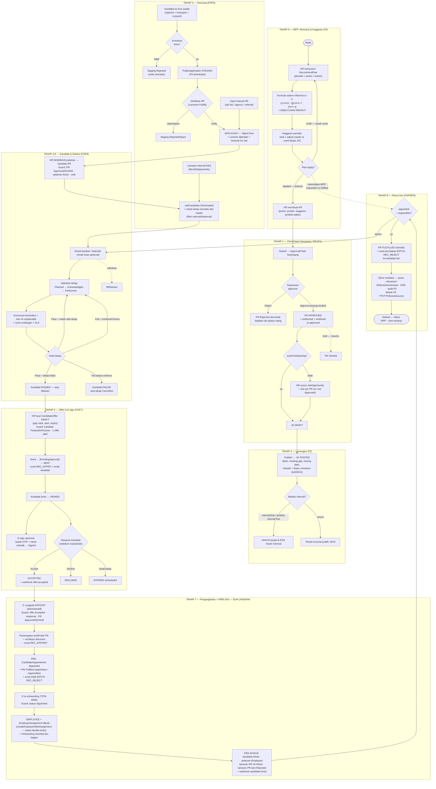
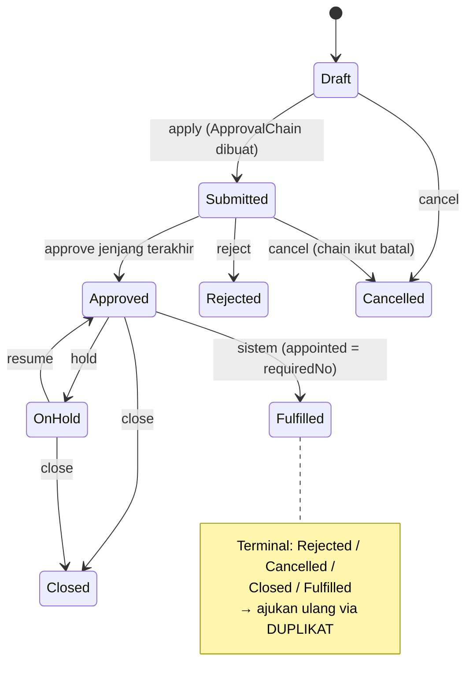
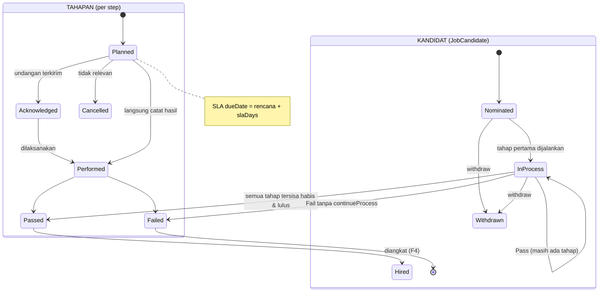
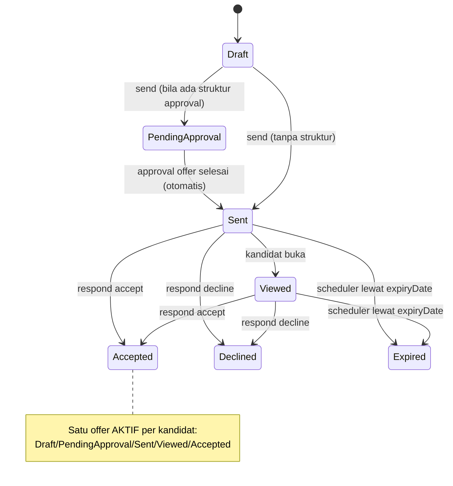
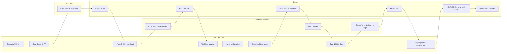

# E2E Business Process — Modul Rekrutmen: MPP → Hire

> Dokumen referensi lengkap proses bisnis ujung-ke-ujung modul Rekrutmen
> RekanKerja — dari **perencanaan tenaga kerja (MPP)** sampai **kandidat
> resmi menjadi karyawan (hire)**. Disusun dari kode aktual (services
> `src/rekankerja/recruitment/services/*`, versi pasca-F9), diverifikasi
> E2E, dan menjadi acuan tunggal alur bisnis modul.
>
> Terkait: `DEVELOPMENT-PLAN-RECRUITMENT.md` (desain) · `src/rekankerja/recruitment/README.md`
> (referensi teknis/API) · `worklog.md` (riwayat implementasi F0–F9).

---

## Daftar Isi

1. [Ringkasan & Aktor](#1-ringkasan--aktor)
2. [Peta Proses Tingkat Tinggi](#2-peta-proses-tingkat-tinggi)
3. [Tahap 0 — MPP: Rencana & Anggaran (F5)](#3-tahap-0--mpp-rencana--anggaran-f5)
4. [Tahap 1 — Permintaan Karyawan / PR (F1)](#4-tahap-1--permintaan-karyawan--pr-f1)
5. [Tahap 2 — Lowongan / Job Opportunity (F2)](#5-tahap-2--lowongan--job-opportunity-f2)
6. [Tahap 3 — Sourcing: 3 Jalur Kandidat (F2/F5)](#6-tahap-3--sourcing-3-jalur-kandidat-f2f5)
7. [Tahap 4 — Nominasi → Kandidat PR (F3)](#7-tahap-4--nominasi--kandidat-pr-f3)
8. [Tahap 5 — Seleksi Terstruktur (F3/F6)](#8-tahap-5--seleksi-terstruktur-f3f6)
9. [Tahap 6 — Offer & E-sign (F4/F7)](#9-tahap-6--offer--e-sign-f4f7)
10. [Tahap 7 — Pengangkatan & HIRE (F4)](#10-tahap-7--pengangkatan--hire-f4)
11. [Tahap 8 — Pasca-hire (F5/F8/F9)](#11-tahap-8--pasca-hire-f5f8f9)
12. [Diagram Aliran Lengkap (Poin 2)](#12-diagram-aliran-lengkap-poin-2)
13. [Matriks Guard / Aturan Transisi](#13-matriks-guard--aturan-transisi)
14. [Kepatuhan UU PDP sepanjang Siklus (F9)](#14-kepatuhan-uu-pdp-sepanjang-siklus-f9)
15. [Matriks Aktor × Menu × Endpoint](#15-matriks-aktor--menu--endpoint)
16. [Jejak Test E2E](#16-jejak-test-e2e)

---

## 1. Ringkasan & Aktor

Modul Rekrutmen meng-cover siklus penuh:

```
MPP (rencana kebutuhan + anggaran)
  → PR (permintaan karyawan + approval berjenjang)
  → Lowongan (iklan + slot + knockout)
  → Sourcing (portal publik / input HR / lamaran internal ESS)
  → Talent pool (verifikasi staging)
  → Kandidat per PR (nominasi)
  → Seleksi (tahapan + scorecard + skor AI + SLA)
  → Offer (surat penawaran + e-sign + expiry)
  → Pengangkatan (HIRE → Employee + onboarding)
  → Pasca-hire (PR fulfilled, surat penolakan, silver medalist, retensi, metrik)
```

**Aktor & perannya:**

| Aktor | Peran dalam siklus |
|---|---|
| **HR / Recruiter** (menu `recruitment:pr` dst.) | Membuat rencana/PR/lowongan, verifikasi staging, nominasi, catat hasil seleksi, buat & kirim offer, pengangkatan |
| **Approver** (menu `recruitment:pr-approval`) | Menyetujui/menolak PR pada jenjangnya (mesin approval berjenjang shared `ApprovalChain`) |
| **Manajer / User Officer** | Memberi skor scorecard tahap; menjadi `performedBy` tahap |
| **Kandidat Eksternal** (portal karir :3010, tanpa akun) | Melamar via form publik, menerima email offer, e-sign via tautan OTP |
| **Kandidat Internal** (ESS → Karier Internal) | Melamar lowongan internal (mutasi/promosi) |
| **Sistem** (scheduler + webhook + otomasi F7) | Auto-post JO saat PR approved, expiry offer, reminder/SLA, retensi & anonimisasi, webhook event, email/notifikasi |

**Nomor dokumen** (registry prefix-tahun-seq): `PR-YYYY-NNNN` · `JO-YYYY-NNNN` ·
`APP-YY-NNNNN` (pelamar) · `CAND-…` · `OFF-…` · `AP-YYYY-NNNN` (pengangkatan).

---

## 2. Peta Proses Tingkat Tinggi

```
Portal karir (publik :3010)                HR / Recruiter (aplikasi utama :3000)
  lamaran + consent ──► PublicApplication (staging, PII terenkripsi)
                            │ verifikasi HR (+ parse CV opsional)
                            ▼
                        Applicant (talent pool)
                            │ apply-to-slot / nominasi / lamaran internal (ESS)
                            ▼
                        ApplicantApplication ── knockout ──► tolak otomatis
                            │
                            ▼
                        JobCandidate (per PR) ──► tahapan seleksi + scorecard + surat undangan
                            ▼
                        CandidateOffer ── e-sign OTP ── Accepted
                            ▼
                        CandidateAppointment ──► Employee + Onboarding HRIS
                                                     (PR otomatis Fulfilled)
   Sepanjang siklus (F9): consent ledger · DSR · audit PII · retensi/anonimisasi
```

---

## 3. Tahap 0 — MPP: Rencana & Anggaran (F5)

> Menu: **Rekrutmen → Perencanaan → Rencana & Anggaran** (`recruitment:plan`).
> Entity: `RecruitmentPlan` (status `Draft → Applied`), `RecruitmentBudget`.

MPP (Man Power Planning) di RekanKerja = **Rencana Rekrutmen** per
periode × posisi × kantor, memakai **Formula sistem referensi a–h** — seluruh kolom
c/g/h **dihitung saat baca**, bukan disimpan:

| Sel | Nama | Sumber |
|---|---|---|
| (a) `targetA` | Target headcount awal | input |
| (b) `adjustB` | Penyesuaian (+/−) | input |
| (c) `totalC` | Total target | **(a) + (b)** |
| (d) `empD` | Karyawan awal | input / sinkron headcount live |
| (e) `inE` | Rekrut / masuk | input |
| (f) `outF` | Turnover / keluar | input |
| (g) `resultedG` | Hasil | **(d) + (e) − (f)** |
| (h) `toRecruitH` | **Kebutuhan rekrut** | **(c) − (g)** |

**Rekonsiliasi ke PR** (PLAN-LINK — dua jalur, eksplisit menang):

1. **Tautan eksplisit** — kolom `PersonnelRequisition.planId` dipilih
   saat membuat/mengubah PR (field *Melayani Rencana MPP*, hanya rencana
   `Applied`). Tautan ini otoritatif: kapan pun posisi/kantor PR diubah,
   rencana yang dilayani tidak bergeser.
2. **Fallback otomatis** (PR `planId` kosong) — dicocokkan dari **posisi
   (id master ATAU judul, case-insensitive) + kantor kompatibel + tahun
   `requestDate` == tahun periode rencana** (scope tahun mencegah PR lama
   ikut terhitung ke rencana periode baru).

- `requested` = Σ `requiredNo` PR berstatus `Submitted | Approved | OnHold | Fulfilled` yang melayani rencana (eksplisit ∪ fallback)
- `fulfilled` = Σ pengangkatan (`CandidateAppointment`) pada PR match
- `unfulfilled` = requested − fulfilled

**Monitoring capaian MPP (dilihat dari requisition):** kolom *Rekonsiliasi
PR* kini menampilkan baris kedua — **capaian vs (h)** dengan semantika warna:

| Kondisi | Indikator |
|---|---|
| `fulfilled ≥ h > 0` | hijau “capaian {ful}/{h} h ✓” — **target tercapai** |
| `0 < fulfilled < h` | amber “capaian {ful}/{h} h” — berjalan ( + “PR {req}/{h}” bila PR belum menutup h) |
| `requested > h` (termasuk h=0) | **merah “melampaui rencana · PR {req} > h {h}”** — hiring over-plan |
| `h > 0, requested = 0` | “belum ada PR (h)” — kebutuhan belum diajukan |

Klik sel rekon = **drill-down daftar PR penyumbang** (badge `eksplisit` /
`otomatis` per PR). Halaman juga menampilkan **banner “PR di luar rencana”**
(PR aktif tanpa tautan eksplisit maupun match fallback — tidak terhitung
dalam capaian MPP mana pun), dan Overview modul menampilkan KPI agregat
**Capaian MPP (Σ fulfilled / Σ h, dedupe per PR)** + jumlah PR di luar
rencana. Di sisi PR: form menampilkan konteks kuota rencana (h, requested,
fulfilled, sisa) + **peringatan lembut** bila `requiredNo` > sisa (tetap
bisa disimpan — ditandai over-plan); daftar PR & kotak approval menampilkan
chip rencana / “di luar rencana”.

**Anggaran** per periode: `totalBudget` + `adjust` (uang vault-encrypted)
vs `used` = Σ `actualCost` metode iklan JO pada periode tsb — dua level
: per Job Opportunity + per PR yang diiklankan. Sisa = unused.

**Siklus hidup rencana:** `Draft` (bisa diubah/dihapus) → **Apply**
(`Applied`, terkunci — revisi = duplikat). Rencana menjadi **basis
justifikasi** pembuatan PR; kebutuhan (h) vs rekonsiliasi PR adalah
kontrol "cukup/tidaknya" pengajuan rekrutmen.

---

## 4. Tahap 1 — Permintaan Karyawan / PR (F1)

> Menu: **Rekrutmen → Permintaan & Persetujuan → Permintaan Karyawan**
> (`recruitment:pr`) · approval di **Approval PR** (`recruitment:pr-approval`).
> Entity: `PersonnelRequisition`.

PR = dokumen formal kebutuhan rekrutmen: posisi/job, org-unit, kantor,
`requiredNo` (jumlah), `employmentStatus` (Permanent|Contract|Probation|
Outsourcing), `preferredSource` (Internal|External|Any), jendela waktu
(`earliestDate`–`latestDate`), `salaryBudget` (vault), `replacedEmployeeId`
(PR penggantian karena attrition), `slaTargetDays`, `autoPostOpening`,
`rubricJson` (rubrik skor AI per PR — F6b), `planId` (tautan eksplisit
rencana MPP yang dilayani — PLAN-LINK, hanya rencana Applied).

**State machine PR:**

```
Draft ──apply──► Submitted ──approval──► Approved ──hold──► OnHold ──resume──► Approved
 │                   │                     │ │
 │                   ├── reject ──► Rejected (terminal)  └── close ──► Closed (terminal)
 ├── cancel ──► Cancelled (terminal)
 └── Approved/OnHold ──close──► Closed
Approved ──(sistem, saat appointed = requiredNo)──► Fulfilled (terminal)
Terminal (Rejected/Cancelled/Closed/Fulfilled) → ajukan ulang via DUPLIKAT (Draft baru, nomor baru)
```

**Approval berjenjang:** submit → `ApprovalChain` (docType PR) dibuat dari
struktur approval tenant; `currentLevel`/`totalLevels`; approver menyetujui
per jenjang (`op:approve` di menu `recruitment:pr-approval`); jenjang
terakhir → PR `Approved` + `decidedAt` + `decisionNote`.

**Saat PR Approved:**

1. Notifikasi + email ke pengaju (`recruitment.pr.approved`).
2. **Webhook** `pr.approved` ter-emit (antrean DB — tanpa PII).
3. Bila `autoPostOpening = true` → **JobOpening (JO) dibuat & diposting
   otomatis** (`autoPostForApprovedPr`) — melompat ke Tahap 2 tanpa input manual.

**Anggaran PR:** `salaryBudget` ikut gating vault uang; PR menyumbang
`requested` ke rekonsiliasi MPP (Tahap 0).

---

## 5. Tahap 2 — Lowongan / Job Opportunity (F2)

> Menu: **Rekrutmen → Lowongan & Kandidat → Lowongan** (`recruitment:openings`).
> Entity: `JobOpportunity` (header iklan) + `JobOpening` (slot per PR).

Satu JO dapat memuat **banyak slot dari banyak PR** (iklan gabungan).
Wajib ≥ 1 slot PR `Approved`.

**State machine JO / slot:**

```
JO:    Draft ──publish──► Posted ──close──► Closed
                         └──(PR ditarik/slot habis)──► Obsolete
Slot:  Open ──(kandidat diangkat F4)──► Fulfilled   ⚠ catatan implementasi: status "Fulfilled"
       │                                           slot TIDAK di-set otomatis oleh kode — lihat §16
       └──(ikut JO Closed)──► Closed
```

**Isi iklan:** judul, deskripsi pekerjaan & spesifikasi, rentang gaji
(publik by design), `lastAcceptDate` (closing date), `datePrepared`, serta
**metode advertensi + biaya** (master Media Advertensi + Cost Item) — biaya
actual inilah yang jadi `used` anggaran MPP.

**Matriks internal (HRX A4):**

- `internalOnly` — JO khusus karyawan (tidak pernah tayang di portal publik).
- `internalFirstUntil` — **jendela internal-first**: selama belum lewat,
  JO tidak tayang di portal publik, hanya di ESS Karier Internal.

**Knockout questions (F6):** per slot — pertanyaan screening dengan kriteria
hard (mis. "Bersedia shift malam?" = Ya). Jawaban dipakai saat apply.

**Publikasi:** slot `Posted` + `Open` + belum lewat `lastAcceptDate` →
tampil di **portal karir publik** (mini-service `:3010`, read-only + form
lamaran anonim).

---

## 6. Tahap 3 — Sourcing: 3 Jalur Kandidat (F2/F5)

### Jalur A — Portal publik (eksternal, tanpa akun)

1. Kandidat buka portal karir → pilih lowongan → form lamaran
   (captcha aritmetika + honeypot + rate-limit + **consent UU PDP**).
2. Submit → **`PublicApplication` (staging)** — PII terenkripsi per-field
   di `payloadJson`; bila **gagal knockout** → staging langsung
   `Rejected` (+ catatan) sebelum menyentuh talent pool.
3. HR membuka **Lamaran Publik** (`recruitment:public-staging`) →
   **verifikasi**:
   - `verify` → **`Applicant` dibuat** (talent pool, jalur produksi
     `createApplicant`), consent staging dipindah ke applicant,
     `ApplicantApplication` ke slot dibuat (bila slot masih layak),
     jawaban knockout disalin ke `ApplicationAnswer` (audit).
   - `reject` / `spam` → staging ditolak/ditandai spam.
4. Auto-reply email konfigurable (`auto.reply.public-application`).

### Jalur B — Input manual HR

HR menambah pelamar langsung ke talent pool (hasil job fair, referral,
agency) — `Applicant` + dokumen + pendidikan/pengalaman/keahlian.

### Jalur C — Lamaran internal (ESS)

Karyawan membuka **ESS → Karier Internal** (`MyJobOpportunity`): slot
`Posted`+`Open` belum lewat closing — termasuk JO matriks internal
(`internalOnly` / dalam jendela `internalFirstUntil`). Apply →
**`JobCandidate` source `Internal`** langsung (Tahap 4 otomatis, jalur
seleksi sama) + jejak `EmpJobApplication`. Withdraw → tahap aktif
dibatalkan + kandidat `Withdrawn`.

**Status pelamar (talent pool):** `Active` → `Rejected` | `Outdated`
(scheduler membalik bila idle) | `Employed` (setelah di-hire) —
+ `Anonymized` (F9, tidak bisa dibuat manual).

---

## 7. Tahap 4 — Nominasi → Kandidat PR (F3)

> Menu: **Rekrutmen → Lowongan & Kandidat → Talent Pool** (transfer)
> + dialog di **Kandidat & Seleksi**. Entity: `JobCandidate`.

HR **memindahkan pelamar talent pool → kandidat PR** (padanan
"Transfer To Job Candidate"):

**Guard:** PR harus `Approved`/`OnHold` · pelamar `Active` · unik
[prId, applicantId] · karyawan internal harus `Active`.

Saat nominasi:

1. `JobCandidate` dibuat (source `External`/`Internal`).
2. **Rantai tahap otomatis** dibuat dari katalog **Tahap Seleksi**
   (master F0), difilter `appliesInternal/appliesExternal` sesuai source
   (mis. tahap "Konfirmasi Kembali" hanya eksternal).
3. `ApplicantApplication` ke slot PR → `Screening` (jejak lamaran).

**Status kandidat:** `Nominated` → `InProcess` → `Passed` | `Failed` |
`Withdrawn` (+ `Hired` setelah pengangkatan).

---

## 8. Tahap 5 — Seleksi Terstruktur (F3/F6)

> Menu: **Rekrutmen → Seleksi & Penawaran → Kandidat & Seleksi**
> (`recruitment:selection`). Entity: `CandidateSelectionStep`,
> scorecard, `CandidateAiScore`.

**State machine tahapan (per kandidat):**

```
Planned ──(undangan)──► Acknowledged ──(catat hasil)──► Performed ──► Passed | Failed
   └── (tidak relevan) ──► Cancelled
SLA dueDate = tanggal rencana + slaDays master Grup SLA
```

**Board kanban per PR:** kolom = tahap; drag antar kolom = catat hasil
tahap aktif (Pass). Mode tampilan kalender jadwal. **Mode buta** (F6c)
menyamarkan nama/institusi untuk mengurangi bias.

**Catat hasil (applyStepResult):**

- `Pass` → step `Passed`; bila masih ada tahap non-terminal → kandidat
  `InProcess`, tahap berikutnya otomatis jadi *current*; bila habis →
  kandidat **`Passed`** (siap ditawari).
- `Fail` + `continueProcess=false` → step `Failed` + **sisa rantai
  dibatalkan** + kandidat `Failed`.
- `Fail` + `continueProcess=true` → kandidat tetap `InProcess`.

**⚠️ GATE scorecard (HRX D2 — terverifikasi E2E):** tahap yang memiliki
**template scorecard aktif terikat** pada prosesnya (mis. "Interview HR —
Screening Awal", "Interview User — Kompetensi Teknis") **WAJIB** memiliki
≥ 1 scorecard **submitted** dengan feedback keseluruhan (`overallComment`)
terisi **sebelum kandidat bisa naik tahap** — advance ditolak dengan pesan
"Feedback scorecard wajib sebelum naik tahap". Submit scorecard sendiri
mensyaratkan: semua kompetensi template dinilai 1–5 + overallComment +
rekomendasi (`StrongHire|Hire|NoHire|StrongNoHire`). Tahap tanpa template
terikat (mis. Psikotes, Medical) tidak ter-gate.

**Scorecard terstruktur (F3):** per kandidat — kategori penilaian &
skala master F0, bobot, skor per kategori + catatan; divergensi
multi-penilai ditandai.

**Skor AI explainable (F6b):** rubrik per PR (default 3 faktor generik,
bisa kustom `rubricJson` — bobot dinormalisasi); hasil = skor 0–100 +
**evidence per faktor** (pendidikan, pengalaman relevan, keahlian,
kesesuaian gaji) — mode simulasi bila AI tidak tersedia; keputusan
tetap manusia.

**Surat undangan:** letter engine template dwibahasa → email kandidat
(`auto.ack.email.candidate`).

**SLA & otomasi (F7):** reminder H-3/overdue (`auto.reminder.selection`),
eskalasi 3/7/14 hari (`auto.escalate.sla`), badge "lewat SLA" di board.

**Knockout ulang:** jawaban knockout audit tetap tersimpan di
`ApplicationAnswer`.

---

## 9. Tahap 6 — Offer & E-sign (F4/F7)

> Menu: **Rekrutmen → Seleksi & Penawaran → Offer & Pengangkatan**
> (`recruitment:offers`). Entity: `CandidateOffer` (+ `EsignRequest`).

**State machine offer:**

```
Draft ──send──► [PendingApproval bila ada struktur] ──auto──► Sent ──kandidat buka──► Viewed
                                                                                  │
                                            ┌─────────────────────────────────────┤
                                            ▼                                       ▼
                                        Accepted                              Declined | Expired
                                   (e-sign opsional)                      (scheduler lewat expiryDate)
```

**Guard pembuatan:** PR `Approved`/`OnHold` · kandidat `Passed`/`InProcess` ·
satu offer **aktif** per kandidat (Draft/PendingApproval/Sent/Viewed/Accepted).

**Isi offer:** gaji (vault), tanggal mulai, `expiryDate` (batas jawab),
surat **REC_OFFER** (letter engine — PDF dwibahasa), catatan.

**Pengiriman:** `sendOffer` → (bila ada struktur approval offer →
`PendingApproval`, surat terbit saat approval) → surat terbit + **email ke
kandidat** + notif officer. Tandai `Viewed` saat kandidat membuka.

**E-sign kandidat (F7):** HR minta tanda tangan → tautan ber-token ke
**portal publik** `/sign/<token>` → kandidat minta **OTP email** → ketik
OTP + **nama terketik** → tercatat `Signed` + `pdfSha256`
(tamper-evident). Bukan TTE bersertifikat (lihat §Limitation README).

**Respons (`respondOffer`):** hanya dari `Sent`/`Viewed` →
`Accepted`/**`Declined`** (dicatat HR) — accept → **webhook
`offer.accepted`** ter-emit + notif officer. `Expired` oleh scheduler
`jobOfferExpiry` saat lewat `expiryDate` (+ reminder ≤3 hari).

---

## 10. Tahap 7 — Pengangkatan & HIRE (F4)

> Dialog pengangkatan di view **Offer & Pengangkatan**. Entity:
> `CandidateAppointment` → `Employee` (+ `EmployeeAssignment`,
> `Onboarding`).

> **PENTING — HIRE adalah DUA LANGKAH** (diverifikasi E2E):
> ① `appoint` = pengangkatan administratif; ② `to-onboarding` =
> penciptaan Employee. Kandidat menjadi **karyawan** hanya pada langkah ②.

### Langkah ① — `appoint` (Pengangkatan administratif)

**Guard (`appoint`):**

- Offer harus **`Accepted`** (ditolak/kedaluwarsa tidak bisa).
- Belum ada pengangkatan untuk offer tsb (idempoten).
- Kandidat harus **eksternal** — kandidat internal (karyawan) TIDAK
  diangkat di sini (gunakan **Aksi Kepegawaian** untuk mutasi/promosi —
  anti double-entry).
- PR masih `Approved`/`OnHold`.

Eksekusi HR: dialog terbuka — **penempatan prefill dari PR** (posisi,
office/work location, supervisor, employmentStatus — boleh dioverride) →
verifikasi checklist dokumen pre-employment → tanggal pengangkatan →
**surat REC_APPOINT terbit**.

**Efek `appoint` (administratif — belum membuat Employee):**

| Efek | Detail |
|---|---|
| `CandidateAppointment` | dibuat, status `Appointed`, `letterNo` surat pengangkatan |
| `CandidateOffer.appointedAt` | diisi |
| **PR otomatis `Fulfilled`** | saat jumlah appointed ≥ `requiredNo` — hook di dalam `appoint()` |
| **Surat penolakan BATCH (REC_REJECT)** | otomatis terbit & terkirim ke kandidat lain di PR yang sama saat PR fulfilled (kandidat lain → `Failed`, sisa tahap mereka `Cancelled`, lamaran slot → `Rejected`) |
| Konsistensi MPP | `fulfilled` rekonsiliasi rencana bertambah (Tahap 0) |

### Langkah ② — `to-onboarding` (Penciptaan Employee = TITIK HIRE)

Guard: pengangkatan berstatus `Appointed` (belum punya `employeeId`) +
kandidat punya data pelamar.

**Efek `continueToOnboarding` (semua atomik):**

| Efek | Detail |
|---|---|
| **`Employee` + `EmployeeAssignment` dibuat** | via `createEmployeeWithAssignment` — PII pelamar diteruskan (email/telepon/alamat/NIK terdekripsi in-memory), gaji dasar dari offer, `joinDate` = tanggal pengangkatan; **tanpa double-entry** |
| `Onboarding` + tugas checklist | dibuat per bagian + email otomatis ke tiap bagian (best effort) |
| `CandidateAppointment` | status → `Onboarded` + backlink `employeeId`/`onboardingId` |
| `JobCandidate.status` | → **`Hired`** |
| `Applicant.status` | → **`Employed`** |
| `ApplicantApplication` ke PR ini | → `Hired` |
| Lamaran aktif pelamar ke **PR lain** | otomatis → `Rejected` ("pelamar telah dipekerjakan") |
| Webhook | **`candidate.hired`** ter-emit DI SINI (bukan di `appoint`) |
| Tombol "Lanjutkan ke Onboarding" | di UI = aksi ini |

Setelah langkah ②, identitas kandidat berpindah ke modul HR (Employee)
dan onboarding berjalan di modul HR (checklist per bagian).

---

## 11. Tahap 8 — Pasca-hire (F5/F8/F9)

- **Silver medalist (F5):** kandidat `Passed` yang tidak diangkat → saran
  talent pool untuk rekrutmen berikutnya (demographics) — kecuali consent
  ditarik.
- **Retensi & anonimisasi (F9):** pelamar `Rejected`/`Outdated` melewati
  `retention.months.*` (default 24 bulan) dianonimisasi scheduler harian
  — kecuali punya consent talent-pool aktif; `Employed` **tidak pernah**
  dianonimkan.
- **Metrik (F8):** time-to-fill (PR approved → fulfilled), time-to-hire
  (apply → appoint), funnel conversion per tahap, source effectiveness
  (metode iklan vs hired), offer acceptance rate, adverse impact 4/5ths,
  proyeksi beban recruiter — dashboard + export CSV/XLSX/PDF.
- **Audit:** seluruh mutasi tercatat `ActivityLog`; akses PII pelamar
  tercatat `PiiAccess`.

---

## 12. Diagram Aliran Lengkap (Poin 2)

### 12.1 Flowchart utama MPP → Hire



### 12.2 State machine PR



### 12.3 State machine Kandidat & Tahapan



### 12.4 State machine Offer



### 12.5 Swimlane aktor (kondisi happy path + cabang utama)



---

## 13. Matriks Guard / Aturan Transisi

| # | Aksi | Guard (harus) | Efek samping |
|---|---|---|---|
| 1 | Plan apply | status `Draft` | terkunci `Applied` |
| 2 | PR submit | status `Draft` | `ApprovalChain` + notif approver |
| 3 | PR approve/reject | status `Submitted` + approver = jenjang current | jenjang terakhir → `Approved`/`Rejected` + notif/email + webhook `pr.approved` + auto-post JO (bila flag) |
| 4 | PR hold/resume/close | `Approved`↔`OnHold`; close dari `Approved/OnHold` | — |
| 5 | PR fulfilled | **hanya sistem** — `appointed = requiredNo` | surat penolakan batch REC_REJECT |
| 6 | Buat JO | ≥ 1 slot PR `Approved` | biaya metode → anggaran MPP `used` |
| 7 | Publish JO | status `Draft` | slot postedAt terisi; tayang portal/ESS |
| 8 | Apply publik | captcha valid + rate-limit + consent | staging `Pending`; gagal knockout → `Rejected` |
| 9 | Verify staging | staging `Pending` | `Applicant` + lamaran slot + knockout answers |
| 10 | Nominasi kandidat | PR `Approved/OnHold` · pelamar `Active` · unik [prId,applicantId] | rantai tahap otomatis (filter source) |
| 11 | Catat hasil tahap | tahap = current & belum terminal | transisi kandidat (§12.3); Fail tanpa continue → sisa tahap `Cancelled` |
| 11b | **Naik tahap (advance)** | bila tahap punya template scorecard aktif terikat: **≥1 scorecard submitted + overallComment** (gate HRX D2) | advance ditolak sampai scorecard lengkap |
| 12 | Buat offer | PR `Approved/OnHold` · kandidat `Passed/InProcess` · tanpa offer aktif lain | — |
| 13 | Send offer | status `Draft` | surat REC_OFFER + email + (approval struktur bila ada) |
| 14 | Respond offer | status `Sent`/`Viewed` | accept → webhook `offer.accepted` |
| 15 | E-sign | offer `Sent`/`Viewed` | OTP email + nama terketik + `pdfSha256` |
| 16 | **Appoint ① (administratif)** | offer `Accepted` · belum ada appointment · kandidat **eksternal** · PR `Approved/OnHold` | CandidateAppointment `Appointed` + REC_APPOINT + slot-bookkeeping + (PR `Fulfilled` bila penuh + surat tolak batch) |
| 16b | **to-onboarding ② (HIRE)** | appointment status `Appointed` (belum ada employeeId) | Employee + assignment + Onboarding + kandidat `Hired` + pelamar `Employed` + lamaran PR ini `Hired` + lamaran PR lain `Rejected` + webhook `candidate.hired` |
| 17 | Nominasi ulang setelah hire | pelamar `Employed` → **DITOLAK** | anti double-entry |
| 18 | Anonimisasi | pelamar **bukan** `Employed` | `dedupHash` + PII null + status `Anonymized` |

---

## 14. Kepatuhan UU PDP sepanjang Siklus (F9)

| Tahap | Kontrol kepatuhan |
|---|---|
| Apply publik | **Consent eksplisit** (processing + talent-pool opsional) — ledger `ApplicantConsent` tidak pernah dihapus |
| Talent pool | PII terenkripsi field-level (`enc:v1:`); list hanya versi topeng; **setiap GET detail → `PiiAccess`** audit |
| Seleksi | Mode buta mengurangi bias; adverse-impact 4/5ths di F8 |
| Ditolak/Idle | Retensi 24 bulan (config) → **anonimisasi irreversibel** (kecuali consent talent-pool aktif) |
| DSR | Hak akses/ekspor/hapus — SLA 7 hari; erase = anonymizeApplicant (bukan hapus baris; lamaran & consent dipertahankan sebagai catatan bisnis/bukti) |
| Hire | Data pindah ke Employee (modul HR) — pelamar `Employed` **tidak bisa** dianonimkan |

---

## 15. Matriks Aktor × Menu × Endpoint

| Aktor | Menu (view id) | Endpoint utama |
|---|---|---|
| HR | `plan` | `plan`, `budget` |
| HR | `pr` | `pr` (create/apply/hold/close/duplicate), `pr-options` |
| Approver | `pr-approval` | `pr` (approve/reject) |
| HR | `openings` | `openings` (JO + slot + knockout) |
| Kandidat | portal :3010 | `public/openings`, `public/apply`, `public/captcha`, `public/sign/[token]` |
| HR | `public-staging` | `public-applications` (verify/reject/spam) |
| HR | `applicants` | `applicants`, `applicant-documents`, `ai` (parse/skor/search) |
| Karyawan ESS | ESS Karier Internal | `ess/my-jobs` (MyJobOpportunity/apply/withdraw) |
| HR | `selection` | `candidates`, `selection` (board/hasil/surat), `ai` (score/copilot) |
| HR | `offers` | `offers` (create/send/respond/appoint), `settings` (e-sign) |
| HR | `demographics` | `demographics` |
| HR | `reports` | `reports` (+export csv/xlsx/pdf) |
| HR | `compliance` | `compliance` (DSR/consent/retention/audit) |

---

## 16. Jejak Test E2E

> Rantai penuh per dokumen ini DIEKSEKUSI NYATA pada environment demo
> (tenant MII, sesi 12 Okt 2026) — hasil & jejak detail di `worklog.md`
> entri **E2E-MPP-HIRE**. Dua kali test menemukan pemahaman keliru pada
> draf dokumen (poin 4 — dipelajari ulang lalu dokumen dikoreksi):
> (a) **gate scorecard** sebelum naik tahap; (b) HIRE ternyata **dua
> langkah** (appoint ≠ to-onboarding).

| Langkah | Verifikasi | Hasil |
|---|---|---|
| MPP: buat plan (a–h) → apply | (c)=a+b=2 · (g)=d+e−f=1 · (h)=c−g=1 ✓ · terkunci Applied ✓ · guard ubah ditolak ✓ | ✅ |
| PR: create → submit → approve | `PR-2026-0010` Submitted → ApprovalChain 1 jenjang → Approved (OWNER decide) ✓ | ✅ |
| JO auto-post (autoPostOpening) | `JO-2026-0005` Posted otomatis + slot PR-0010 ✓ · stats 4→5 ✓ | ✅ |
| Rekonsiliasi MPP live | requested=1 setelah PR submit ✓ | ✅ |
| Apply publik + consent | captcha solve → staging `Pending` · PII terenkripsi ✓ · 201 anti-enumeration ✓ | ✅ |
| Verify staging | `APP-26-00011` dibuat + lamaran slot + consent dipindah ✓ | ✅ |
| Nominasi | `JobCandidate` + 5 tahap otomatis ✓ | ✅ |
| **Gate scorecard** | advance ditolak tanpa scorecard (pesan benar) → submit scorecard 2 tahap ter-gate (3 kompetensi + feedback + rekomendasi) → advance lolos ✓ | ✅ (ditemukan test) |
| Seleksi 5/5 tahap Pass | kandidat `Passed` ✓ · tahap: Interview HR → Psikotes → Interview User → Offering Salary → Medical Check Up ✓ | ✅ |
| Offer: create → send | masuk `PendingApproval` (struktur approval offer) → approve → `Sent` + surat `006/HR-RC/X/2026` ✓ | ✅ |
| Viewed → Accept | `Viewed` → `Accepted` ✓ | ✅ |
| Guard e-sign timing | request e-sign pada offer Accepted DITOLAK dengan pesan aturan (hanya Sent/Viewed / setelah pengangkatan) ✓ | ✅ (ditemukan test) |
| **Appoint ①** | surat `007/HR-RC/X/2026` + appointment `Appointed` + **PR Fulfilled** (1/1) ✓ · kandidat masih `Passed` / pelamar `Active` (sesuai 2-langkah) ✓ | ✅ |
| **to-onboarding ② (HIRE)** | **`MII00046` Employee dibuat** + assignment GA Staff @Finance&Accounting + Onboarding 8 tugas + 5 email bagian ✓ | ✅ |
| Efek terminal | kandidat `Hired` · pelamar `Employed` · lamaran `Hired` · appointment `Onboarded` + backlink ✓ | ✅ |
| MPP tertutup | recon akhir: **requested=1 · fulfilled=1 · unfulfilled=0** ✓ | ✅ |

**Catatan implementasi (ditemukan saat test — perilaku aktual):**

- Status slot `Fulfilled` didefinisikan di domain (`OPENING_STATUSES`)
  tetapi **tidak pernah di-set otomatis** oleh `appoint`/`to-onboarding` —
  slot tetap `Open` sampai JO ditutup manual. Sumber kebenaran
  kepuasan kebutuhan = **PR `Fulfilled`**; guard nominasi/offer tetap
  menolak PR `Fulfilled`, jadi tidak ada efek fungsional — hanya status
  tampilan slot yang tidak berubah.
- E-sign offer-stage hanya bisa saat offer `Sent`/`Viewed`; setelah
  `Accepted`, e-sign tersedia untuk **surat pengangkatan** (setelah
  appointment terbit).
- Approval PR dapat diputuskan oleh approver jenjang, **delegate aktif**,
  atau **OWNER/ADMIN/HR workspace** (jalur yang dipakai test).
- **PLAN-LINK (pasca-rilis dokumen ini):** hubungan MPP↔PR awalnya murni
  implisit (match posisi tanpa scope periode). Sejak task PLAN-LINK:
  kolom `planId` eksplisit (hanya rencana Applied) + fallback dengan
  scope tahun + capaian vs h + drill-down + banner PR di luar rencana —
  lihat Tahap 0. Duplikat PR mewarisi `planId` (bisa diubah). Rencana
  `Applied` tidak bisa dihapus, jadi tautan eksplisit tidak pernah
  dangling.
